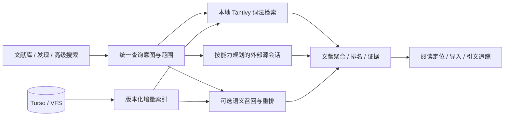

# 文献检索与 GUI 下一阶段计划

交付状态（2026-10-28）：P0–P5 六个阶段均已各自提交；当前按用户确认的基本可用性标准收口。剩余性能/真实库/跨平台限制及各项证据见[交付核对](literature-search-delivery-audit_zh.md)。本页较早的阶段日志保留当时状态，不能覆盖本条最终记录。

P4 精确排序补充（2026-10-28）：借用 Top-K 和最多 4 线程的逐块扫描已验证，保持块内 f64 累加与并列规则。冻结 release 合成测量中，100k 篇/700k 块/1024 维宽范围排序 P95 约 629→340ms，中位数约 515→240ms，所比结果/评分逐位一致；窄范围存在波动，完整分布如实保留。这里只测排序，不能代替端到端性能或持续写入验收。最终源码索引/API、单 CPU 回退与严格 Clippy 已通过，先前并行版本另有 419 项回归。见 [精确排序资格](benchmarks/literature-search-p4-exact-rank-linux.json)及[交付核对](literature-search-delivery-audit_zh.md)。

P5 原生验证补充（2026-10-28）：实际 Linux Tauri/WebKitGTK 的引文/被引、两种推荐范围、精确 ID 重新获取后导入、不可变快照及系统保存对话框导出、订阅检查/目标集合导入/编辑/暂停恢复/额度、切换工作区与显式取消、页面重载均通过，严格 Clippy 通过。来源使用独立本地 fixture，未将其当作公网来源或打包应用资格；最终阶段隔离和其余门槛仍待完成。见 [原生资格](benchmarks/literature-search-p5-native-linux.json)。

当前执行（2026-10-28）：有界清理版本的独立构建/360 项后端及严格 Clippy、浏览器/模拟桥接、真实 Qwen 功能复核均通过。100k 篇/200k 附件/700k 块完整功能运行成功结束，含写入收敛、非首选附件原始字节与证据、删除/替换及旧游标失效，最终修订 500073、700k 块、无错误。共享主机宽查询热 P95 约 3.25 秒、四客户端约 9.04 秒；40 次写入是短突发，不能当作长期可用性验收。性能、最终原生/恢复与阶段隔离仍需收口，P4/P5 均未提交。见 [有界清理资格](benchmarks/literature-search-p4-bounded-cleanup-linux.json)。

P5 当前增量：自动调度、持久额度等待、执行历史和 API 已实现；50 项后端专项及 4 项 HTTP 用例通过（含独立连接资源恢复）；严格 Clippy 通过，Crossref 兼容性修改前的合并工作树完整后端回归 461 项通过，0 失败、0 忽略（含 3 项文档用例）；阶段隔离资格仍需收口。订阅 GUI 已接入并通过浏览器/模拟桥接、标识核验、引文/发现回归、类型检查和 GUI 构建，见 [GUI 资格](benchmarks/literature-search-p5-subscriptions-gui-linux.json)。Crossref offset/游标兼容性与失效游标后台重放已验证，83 项专项及公开 Crossref 小范围请求通过；修改后的完整后端回归 468 项通过、0 失败、0 忽略，见 [来源资格](benchmarks/literature-search-p5-source-compat-linux.json)。真实 SIGKILL 接管、旧进程恢复后的请求隔离、关闭数据库家族备份恢复和跨进程额度等待验证均通过，见 [进程恢复资格](benchmarks/literature-search-p5-subscription-recovery-linux.json)。实际原生 GUI 已通过，见文首原生资格；其余来源范围及最终阶段隔离回归仍待完成，调度/API 见 [资格记录](benchmarks/literature-search-p5-scheduler-linux.json)。
上一轮状态（2026-10-28）：P0–P3 已提交，P4/P5 均未提交。全量 NeuCLIRTech 中文独立评价已完成：395,927 篇、110 查询，冻结 Qwen 配置的 nDCG@20 为 0.446672，词法为 0.300555，相对提高 48.62%；18 查询退化，混合后端单次查询 P95 约 4.95 秒，不能作为普遍质量或性能承诺。详见 [中文质量收据](benchmarks/literature-search-p4-neuclir-hybrid-linux.json)。最新 100k 附件恢复运行已终止：200k 附件导入/验证完成，700k 块初次就绪约 873.9 秒，但后续验证报 `database is locked`，未通过完整容量验收，确切失败操作仍在定位。P4 分批复制版本的隔离后端 354 项通过；索引选择修正后的 27 项专项回归及严格 Clippy 通过。P5 引文探索、确认导入和不可变搜索快照已接入并分别测试；订阅已有独立持久规则、租约、页面原子存储与窗口规划，调度/API/GUI 尚未实现，见 [订阅设计](literature-search-p5-subscriptions-design_zh.md)。后文旧轮次记录保留历史语境，当前状态以文首记录为准。

锁错误排查：独立副本中，原单条 SQL 复制 700k 绑定约 128.2 秒后复现相同 Busy 错误。现已改为每批 2,048 条、修订检查、续租和原子提交，并明确使用现有主键索引；Turso 默认给有界范围复制选择文章索引，会每批扫描整代。实际 700k 分批复制已完成，全部绑定内容 SHA-256 一致且旧发布头不变；调试构建耗时约 398.9 秒，期间存在其他构建/文件复制，不作生产性能或受控提速结论。100 篇端到端验证通过，100k 完整服务复测已终止：初始索引、宽/窄/四客户端测量和增量绑定复制完成，但持续写入后的发布阶段再次报 `database is locked`；初次 700k 块就绪约 1,531.9 秒，宽查询热 P95 约 1.58 秒，四客户端约 6.48 秒，均是共享主机观测且尚无完整成功收据。独立副本中，700k 绑定的未引用旧代级联删除也在约 159.2 秒后复现 Busy；真实发布阶段仍需细分定位，有界旧代/向量清理及该规模性能仍待处理，不能宣布容量通过。见 [故障与修复资格](benchmarks/literature-search-p4-binding-copy-linux.json)。

审查日期：2026-10-28。本次续审基线为 HEAD `222a37d` 与当前未提交工作区。P0–P3 已形成阶段提交；P4 已有真实英文候选实验、固定版本模型、持久向量、配置服务、V2 混合查询与 GUI 主题/证据/规则恢复闭环，维护操作与 SIGKILL 恢复已验证；完整容量/恢复与中文质量仍待实现。详见 [P4 实施细化](literature-search-p4-design_zh.md) 和 [评价记录](benchmarks/literature-search-p4.md)。服务/主链路分别见 [服务收据](benchmarks/literature-search-p4-service-linux.json)和[混合查询收据](benchmarks/literature-search-p4-hybrid-linux.json)，GUI 与真实 Linux 原生验证见 [GUI 收据](benchmarks/literature-search-p4-gui-linux.json)；相关性与集成验证分别说明，不将当前闭环视为整个 P4 完成。

## 目标与建议

当前并行状态：P4 仍等待两个固定程序的长任务结果；P5 引文/相似论文与快照列表、捕获及导出已接入 API 与 GUI，引文导入预览已交接，完整恢复和订阅仍待完成，按 [P5 设计与暂存边界](literature-search-p5-design_zh.md)分开验收和提交。

多附件增量已完成 100/10k 真实 HTTP 上传、提取与 VFS 闭环，10k 共 20k 附件、70k 分块，宽查询热 P95 138ms，四客户端 562ms。试跑发现非首选附件删除未推进 outbox，现已在同一事务修复；350 项后端测试及严格 Clippy 通过。100k/700k 块测试在运行，不提前报告结果。40 次写入突发中词法可用、混合均返回显式版本冲突，停止后追平，持续写入可用性仍待解决。独立源码快照的 Rust 构建与实际 Linux Tauri/Qwen 功能测试已通过，排除其他工作区阅读器/主入口修改。见 [多附件与隔离原生记录](benchmarks/literature-search-p4-attachments-linux.json)。

资源工作包已实现并验证，见 [资源收据](benchmarks/literature-search-p4-resource-limits-linux.json)：块数、UTF-8 输入、事务内向量载荷预算和协作式缓存文件预算均已接入配置与 GUI。实际 Qwen 修复在 16 块后遇限，只调整预算便保留同一任务/私有缓存，复用 16 块、补算 4 块；用户暂停不被预算保存解除。349 项后端测试通过（含原默认忽略的 3 项 Zotero 用例），严格 Clippy、浏览器/实际 Linux 原生和隔离 GUI 构建通过。设置页标题与保存操作固定，长内容独立滚动。下一步重心转到多附件规模、持续写入与长时间批次，随后质量和阶段收口；不将资源预算当作整个 P4 完成。

最新验证补充：已完成真实 HTTP 和浏览器的 10k/100k 合成容量、磁盘副本文件缓存建议清理后的启动观察、词法排名不变性，以及排除其他工作区修改的 GUI 构建。详见 [HTTP 收据](benchmarks/literature-search-p4-http-capacity-linux.json)、[浏览器收据](benchmarks/literature-search-p4-browser-capacity-linux.json)、[隔离 GUI 构建](benchmarks/literature-search-p4-isolated-gui-linux.json)和 [P4 新增说明](benchmarks/literature-search-p4.md#http浏览器与磁盘启动复核)。100k 浏览器 Enter 至可见代理指标约 532ms；后续按行号分批加载将磁盘建议清缓存后的索引就绪单次约 16.1→5.94 秒、首结果约 20.5→10.6 秒，热 HTTP P95 仍约 415ms，峰值 RSS 增加约 31MiB。详见 [启动对照](benchmarks/literature-search-p4-startup-linux.json)，首次查询、资源边界仍需优化。它们使用受控模型，不是实际推理或真实论文质量。中文人工判断工具已就绪；现已取得并固定 NeuCLIRTech 中文论文及人工判断，见 [来源与转换审查](benchmarks/literature-search-p4-neuclir-source-linux.json)。395,927 篇文献、110 条官方查询和 35,962 条判断已完成结构校验；全量词法基线 nDCG@20 为 0.300555，实际固定 Qwen 混合计算正在运行，尚无混合收益结论。

把产品目标落实为四种任务：准确找到已知论文；在本地正文与批注中找到证据；跨源发现并可靠导入；沿引用关系持续追踪研究。

建议沿用 Rust + Turso + Tantivy + VFS + Zotero 对象模型，下一步完成 P4 混合检索及配套 GUI，再实施 P5 引文、快照与订阅。性能、可访问性和跨平台验收贯穿各阶段。当前重点是已有系统的质量收口与增强，避免重复开发 P0–P3。

## 当前代码判断

| 能力 | 代码与当前状态 | 对后续工作的影响 |
| --- | --- | --- |
| 查询模型 | `bib-types/src/search.rs` 的 V2 AST 已支持字段、短语、嵌套 AND/OR/NOT、范围、排序和游标 | 继续以同一 AST 服务文本输入与图形构建器；不能因某源能力弱而静默删除条件 |
| 本地检索 | `bib-base/src/local_index.rs`、`search_analyzer.rs` 已有 Tantivy、BM25、标识符处理和科研文本分析 | 保留词法主干；真实领域相关性评价优先于直接更换引擎 |
| 一致性 | `search.rs`、`search_projection.rs` 已有 outbox、revision/token 和独立检索连接 | 存储写入与检索分离已有基础；重建与查询仍共用检索队列，维护期间搜索可能等待 |
| GUI / 阅读 | `bibliography.tsx` 及搜索组件已有精确筛选、分面、保存搜索、虚拟列表、证据和阅读跳转 | 继续完善任务闭环；缺少可靠映射时只提供真实文本定位，不补猜测页码 |
| 联邦发现 | `discovery_plan.rs`、`discovery_sessions.rs`、`discovery_merge.rs` 已有逐源会话、预算、取消、游标、强 ID 归并和来源信息 | P3 已有主体实现，应按源验收，而不是再新建一套搜索网关 |
| 导入 | `discovery_import.rs`、`discovery_acquisition.rs` 已有预览、指纹校验、逐项事务和全文获取队列 | 需要继续验收并发重复导入、已有人工元数据保留、失败恢复和容量行为 |
| 外部源 | PubMed / OpenAlex / arXiv / Crossref / S2 均已有发现适配和本地资格记录；S2 区分 bulk、relevance 与 lookup | P3 本地验收已完成；bioRxiv 保持 fetch-only 明示 |
| 语义模型 | 未提交的 `text-embedding/src/provider/pinned_ollama.rs` 已实现固定模型 digest、批次核验；已有 Qwen/BGE 与融合评价工具 | 继续使用已冻结的候选配置；没有证据时不增加重排或默认启用 |
| 持久向量索引 | 未提交的 `bib-base/src/semantic_index.rs` 已有独立存储、内容 hash 缓存、outbox 增量、generation 发布与硬范围内排序，以及对应测试代码 | 已由独立后台服务调用；当前为精确向量扫描；混合查询和 GUI 已有资格记录，10k/100k 内部合成容量已测，完整服务容量继续验收 |
| 语义服务 | `semantic_service.rs` 与 `/search/semantic` 已有持久配置、独立连接、后台同步、跨句柄配置观察、模型切换与查询准备取消 | 默认关闭；已有批次进度、重建、隔离修复与持久暂停/恢复；容量验收继续实现 |
| 混合查询与 GUI | `hybrid_search.rs`、actor 和主 GUI 已接通主题/硬条件、模式/URL/规则恢复、候选池说明、真实证据、取消与配置；Linux 实际 WebView 使用 Qwen 完成全文证据定位与重载 | 容量、完整恢复与中文真实质量是当前核心工作；其他平台和人工可访问性仍为发布门槛 |

代码审查发现的重点风险：

1. `local_index::run_query` 以全部索引文档数作为 TopDocs 上限，再聚合和排序；返回 50 条不等于仅处理 50 条。宽词、纯 NOT、大集合和并发查询应单独压测。
2. 现有 P2 基准记载 100k 合成库纯 NOT 热 P95 约 202ms，但同类别首次约 1026ms；不能只报热缓存，也不能当作 GUI 或真实库指标。
3. 导入匹配的 `load_index` 按目标库扫描标识符；已有 P3 合成基准显示 100k 单项预览约 557ms P95。按需评估规范化标识符持久化索引及升级回填，保持同样的归并正确性。
4. Crossref 跨字段 OR 被转成交集的风险已修正，DOI AND/OR 分组求交也已有回归。后续来源继续逐一验证表达式翻译，不沿用扁平参数转换假定语义相同。最新证据见 [Crossref 资格记录](benchmarks/literature-search-p3-crossref-linux.json)。
5. `bibliography.tsx` 当前 1225 行，发现视图也集中较多操作状态。功能稳定后按查询、列表、详情、导入任务提取职责，保持已有行为与跨工作区状态。
6. 现有路线图前半部分保留了早期阶段描述，与末尾执行记录存在时间差。后续阶段交付应同时更新能力矩阵、API 和验收记录。
7. 向量模块无变更的 `sync` 已复用不可变内存快照；仅元数据修改现已复用根绑定，100k 单次发布约 62ms，连续编辑不增长引用链。内容替换和删除仍需物化绑定；多块全文与持续写入的写放大继续验收，不能把元数据优化推广到全部变更。
8. 精确向量扫描已有 10k/100k、1024 维内部合成容量证据，完整资源上限仍未验收。100k 条 1024 维 f32 向量仅数值就约 391 MiB，尚未计入对象、映射、数据库缓存与新旧 generation；全文分块会按块数放大。ANN 选型应由实测决定，且仍须满足硬条件，不可先取全库 Top-K 再过滤。

上述 P2/P3 性能数字来自仓库既有收据，本次未重跑对应容量基准。本次新增 P4 服务的测试与模型探针单独保存在资格收据。参考 [P2 基准](benchmarks/literature-search-p2.md)、[P3 基准](benchmarks/literature-search-p3.md)。

## 产品对标与设计选择

| 参照 | 官方资料确认的能力 | 本项目采用的设计 |
| --- | --- | --- |
| [Zotero 搜索](https://www.zotero.org/support/searching) | 快速搜索范围、高级条件、持续更新的保存搜索、附件全文索引及状态 | 明确当前库/集合与内容范围；保存规则；索引覆盖、失败和维护状态可见 |
| [Zotero 去重](https://www.zotero.org/support/duplicate_detection) | 疑似重复检测、字段版本选择、合并保留集合和标签 | 强 ID 自动归并与弱相似人工审查分开；保留字段来源及人工编辑 |
| [Mendeley 搜索](https://static.mendeley.com/md-stitch/releases/live/03-searching-and-organizing-references.f40ca0f6.html) | 集合内搜索，桌面字段/短语/排除与摘要、PDF 范围控制；网页功能不同 | 提供少量清晰范围预设和高级入口；浏览器与 Tauri 共用后端语义，分别验收 |
| [JabRef 库内搜索](https://docs.jabref.org/finding-sorting-and-cleaning-entries/search) / [外部搜索](https://docs.jabref.org/collect/import-using-online-bibliographic-database) | 字段、精确匹配、布尔组合、历史，外部源选择与导入检查 | 面向专业用户保留字段语法与源原生查询；导入前检查目标库、重复与版本 |
| [Google Scholar](https://scholar.google.com/intl/en/scholar/help.html) | 相关性/时间排序、被引、相关论文、多个版本、全文入口和提醒 | 结果围绕阅读与扩展发现组织；Scholar 提供浏览器跳转入口，自动接入另行论证 |
| [PubMed](https://pubmed.ncbi.nlm.nih.gov/help/) | 专业字段/布尔/邻近查询、主题映射、检索解释及相似论文 | 公开实际执行查询和转换说明；通用检索与单源专业检索分开 |

不照搬各工具的符号语法；用户界面维持一套稳定语法，源适配负责翻译与能力声明。对能力有损的执行需要明确说明和用户主动选择，严格排除条件、标识符和范围不能丢弃。

## 架构与查询原则

已补齐生产推理 context/token batch 配置及高级 GUI，缺省兼容旧配置和缓存签名；显式参数进入签名。参数初次资格见 [推理参数记录](benchmarks/literature-search-p4-inference-options-linux.json)。之后已通过 4 篇真实长摘要的 BGE 超限拒绝、恢复、参数/分块缓存隔离及增量重开，以及真实 Qwen/Linux 原生的高级参数保存和页面重载，见 [长输入/原生记录](benchmarks/literature-search-p4-long-input-linux.json)。新读取器的完整后端回归为 334 项通过、3 项忽略，相关库/测试及新示例严格 Clippy 已通过；旧告警通过移动原辅助函数位置消除。继续验证多附件规模、持续写入、长时间批次、缓存配额和真实质量，不用小规模探针代替这些门槛。



- 统一用户意图与结果契约；本地查询和外部会话保留各自生命周期。
- 精确 ID 优先；普通词法检索与语义扩展显式区分。专业布尔模式的硬约束不得被模型覆盖。
- scope、权限、回收站过滤在结果交付前校验，筛选在计数与分页前生效。
- 归并以 DOI/PMID/来源 ID 等强证据为主；预印本与正式版建立关系，标题相似只提示。
- 来源原始分数不直接比较；先保留分源排名，再融合已召回候选。来源总数与已取得去重数分别显示。
- 证据绑定 item/attachment/annotation、内容版本及真实位置；附件替换后旧定位必须识别失效。
- 每源定义字段、操作符、筛选、排序、游标、认证、预算和错误类型。官方限制会变，资格测试与观测响应头共同约束执行。

特别注意：[OpenAlex 现行认证说明](https://help.openalex.org/api/authentication/)允许无 key 基本查询，但首批之后的 cursor paging 需要 key；[Crossref 官方说明](https://www.crossref.org/documentation/retrieve-metadata/rest-api/tips-for-using-the-crossref-rest-api/)要求正确使用游标、缓存和 429 退避，并提示索引变化会影响长时间遍历。源出错不能显示为零结果。

本次重新核对了 Zotero、JabRef、Google Scholar、PubMed 和 OpenAlex 官方页面。Zotero 的保存搜索只保存规则并动态更新；JabRef 提供字段、精确匹配与括号布尔；Scholar 将相关论文、被引和提醒放进阅读后的发现路径；PubMed 提供 Search Details 与相似论文。这些能力分别对应本项目的范围控制、专业查询、查询可解释性和 P5 持续发现，不等同于可直接复用其内部排序算法。Mendeley 行为沿用前次资料记录，本次不作为新版能力已重新验证的结论。

## GUI 设计

沿用三栏布局，保留“文献库 / 发现”两个入口及独立状态。

```text
左栏：库、集合、保存规则
中栏：搜索 [当前集合] [搜索内容范围] [高级]
      年份 / 类型 / 标签 / 全文 / 批注
      文献数 · 排序 · 表格/片段视图
      标题、作者、年份、来源或期刊
      真实命中片段 → 展开证据 → 打开原文
右栏：详情 / 命中证据 / 来源与版本 / 引文
发现：源进度与问题 → 已在库状态 → 选择版本 → 导入预览
```

具体交互：

1. 关键词输入保留 250ms 防抖、Enter 立即执行和 IME 保护；主题与外部搜索显式提交。默认只展示常用范围与条件。
2. 普通用户看到可用数据源、状态和清晰失败原因；执行参数、预算与原生语法放在“检索详情/专业模式”。专业模式由来源专用表单辅助，保留高级参数编辑。
3. 原生查询只绑定一个来源；按源保留草稿。条件不支持时在提交前提示，执行后仍保留实际查询和近似匹配说明。
4. 结果加载保留旧列表；新源到达时显示新结果提示，避免选中行移动。翻页、重新排序和刷新区分处理。
5. 一篇论文一行，展开附件或批注证据；全文获取与元数据导入分别展示状态，单项失败可重试。
6. 返回列表恢复查询、筛选、选择与滚动。桌面窄窗口和键盘操作作为固定验收场景；人工屏幕阅读器验证独立记录。
7. P4 新增显式“关键词 / 主题”模式。主题描述与高级硬条件分别保存和展示，例如主题“免疫细胞表达调控”，硬条件“2020–2026，排除指定标签”。模式切换不静默重解释原有表达式。
8. 主题检索首次启用显示模型、运行位置和发送内容范围；主界面只显示可用状态、覆盖率和修复入口，digest、RRF 等参数放进高级设置。服务不可用时允许用户主动切回关键词，并明确显示实际执行模式。
9. 语义结果使用“相关段落 / 摘要”证据，不把主题相似伪装成逐字命中；结果数区分候选数与完整词法匹配数。点击打开真实对象，缺少位置映射时使用现有文本定位。

P5 的 GUI 按下表落实；这些是待交付任务，不是当前已可用功能。

| 用户任务 | 页面与实现落点 | 验收场景 |
| --- | --- | --- |
| 从一篇文献继续探索 | 详情侧栏增加“参考文献 / 被引 / 相似论文”；复用发现候选展示和导入预览，独立保存各标签页的位置与选择 | 切换种子文献时取消旧请求，迟到响应不覆盖；方向、来源、获取时间可见，推荐不计入引用数 |
| 保存本次结果 | `bibliography.tsx` 与发现视图提供“保存结果快照”；`saved-searches.tsx` 的动态规则入口保留 | 保存时重新执行并校验结果版本；显示实际保存篇数、范围与未完成来源；操作重试不会产生第二份记录 |
| 查看与导出历史结果 | 独立快照列表、只读详情和 RIS/BibTeX/JSON 导出；展示保存时间和当时条件 | 原文献修改、删除及会话过期后，记录和导出仍保持保存时内容；重新打开原文识别内容版本变化；超限不生成残缺文件 |
| 追踪研究更新 | 保存规则的订阅设置与库内收件箱；提供频率、来源、每轮预算、暂停/恢复及最近成功时间 | 重启后继续；失败显示可重试原因；部分来源失败不显示“无新增”；同一候选不重复通知 |
| 在探索与阅读间往返 | 复用现有 URL、规则、列表恢复与阅读定位，分别保存发现、引文、快照状态 | 返回恢复查询、标签页、选中项和滚动；窄窗口操作可达；弹窗焦点与关闭返回位置正确，实际屏幕阅读器另行验证 |

优先完成列表、状态和导入闭环，再评估引文图谱。结果区只显示帮助判断的信息；模型参数、查询翻译和来源调用明细放进可展开详情。

## 分阶段实施与交付

沿用现有 P0–P5 编号，不重新实施已完成阶段。建议每阶段形成一个可审查的功能交付与验收记录。

| 阶段 | 当前状态 | 后续工作 | 完成判据 |
| --- | --- | --- | --- |
| P0 契约与评价 | 已提交 `01452ed` | 补充真实语料、人工判断与业务任务基线 | 版本化查询集合、数据说明、指标及独立验收划分 |
| P1 本地词法引擎 | 已提交 `032a685` | 宽查询/并发/维护时延实测，按瓶颈优化聚合、过滤和分面 | 正确性不退化；冷/热/维护与资源指标分别报告 |
| P2 搜索与阅读 GUI | 已提交 `871890f` | PDF 映射覆盖、跨平台、人工可访问性；按需提取组件职责 | 集合检索到原文再返回的完整任务通过；缺失映射明确降级 |
| P3 多源发现 | 已提交 `222a37d`，完成本地阶段验收 | 发布前补齐真实库及平台证据；阶段记录见资格收据 | 源能力和真实执行一致；快源独立交付；来源可追溯；导入幂等且保留人工数据 |
| P4 混合检索 | 进行中；英文候选实验、向量/服务/查询与 GUI 闭环已有未提交代码 | 中文领域判断、容量和完整恢复验收 | 独立判断集证明主题检索收益；精确 ID、范围、排除和专业布尔无语义退化 |
| P5 持续发现 | 引文/推荐列表与快照 API/GUI 已接通并有本地资格 | 实际原生/恢复与持久订阅 | 快照可还原执行；订阅有持久水位、幂等去重、失败恢复和预算 |

P3 已完成阶段提交，保留真实上游、真实库、跨平台与人工可访问性的发布验收，不再安排重复接入。

P4 剩余工作按以下依赖执行。各工作包可以分别审查，完整阶段收口后再形成 P4 提交。

| 顺序 | 工作包与主要落点 | 完成判据 | 估计工程日 |
| --- | --- | --- | --- |
| 1 | 配置与 worker：持久配置、独立连接、有界控制队列、状态与取消已实现；细粒度进度与重建/修复/暂停/恢复入口已实现并验证 | 默认关闭；模型 digest 或预处理变化隔离新代；embedding 不占用写入与词法队列；重启可继续同步 | 原预算 2–3，主体已完成 |
| 2 | 查询契约与执行：semantic_query、硬条件前置、融合分页、证据/导出和游标绑定已接通 | 确定性用例与真实 Qwen 探针通过；扩大容量与质量验收继续由后续工作包完成 | 原预算 3–4，主体已完成 |
| 3 | GUI 与两端传输：显式主题/条件、模型/范围配置、状态、取消、候选说明、证据、规则与 URL 恢复已接通 | 浏览器/模拟桥接和真实 Linux Tauri 已通过；实际 Qwen 打开第二附件、定位原文、重载与停用有证据，其他平台另验收 | 原预算 2–3，主体已完成 |
| 4 | 中文与领域质量：已取得并冻结 NeuCLIRTech 全量中文文献、110 条查询及人工判断，转换与 nDCG@20 工具已验证；全量词法已打分，实际固定模型混合计算正在运行 | 100–200 条真实任务；训练/调参与独立验收分开；报告中英、领域、查询类型和退化案例；禁止用自动生成相关性代替人工判断 | 2–3，另需标注工时 |
| 5 | 容量与恢复：已有内部/HTTP/浏览器、恢复、启动优化及资源预算；预算失败等待/修复续算已验证 | 继续全文块扩张、持续写入、真实长批次和完整恢复矩阵；配额已实现，补更广压力；冷/热、WAL、RSS、模型及端到端分别记录 | 原预算 2–4，剩余按瓶颈复估 |
| 6 | 阶段收口：隔离 GUI 构建已通过，继续 Rust 隔离构建与 API/配置/GUI 文档核对 | 相关性、正确性、恢复与 GUI 证据齐全；实验范围和发布门槛清晰；一个 P4 提交 | 原预算 1–2 |

以上原预算合计 12–19 个工程日；服务、查询和 GUI 主体已推进，剩余质量、容量/恢复、维护和阶段收口约 6–11 个工程日，人工标注与外部平台等待另计。默认从标题/摘要开始，全文/批注向量更广覆盖仍单独验收，不用单个 TXT 示例代替完整 PDF/SDT 映射资格。重排只有独立证据证明增益后才启用。

既有英文 SciFact 收据显示冻结候选在 300 条 test 的 nDCG@10 为 0.71263，生产 analyzer 的宽召回词法 OR 基线为 0.56873，相对提高 25.30%。这是已有离线证据，不是本次重跑，也不是中文或 GUI 验收。沿用已冻结参数，不继续以同一 test 调参；新增中文验收集同样在调参前隔离。

P5 内部执行顺序：引用/被引列表 → 相似论文 → 执行快照与 RIS/BibTeX/JSON 导出 → 订阅。动态保存搜索保存规则，快照保存某次执行与已取得结果；快照记录截断和部分失败，不宣称外部索引未来可完全重放。订阅用更新/索引时间水位与重叠窗口，避免仅按发表日期漏掉回填数据；通知渠道单独配置。

P5 预计 6–10 个工程日：引文与相似论文 2–3 日，快照与导出 2–3 日，持久订阅、去重及失败恢复 2–4 日。首版优先列表和库内通知；图谱展示、生成式问答、自动联系外部人员不属于该交付范围。每条引用边保留来源和抓取时间，相似推荐与真实引用关系分别标识。

## 验收与优先级

先建立 100–200 条人工判断查询，覆盖已知论文、主题检索、中英文、科研符号、复杂布尔、正文证据与跨源版本。人工标注作为相关性依据，合成数据用于规模和边界；调参与验收集分开。跨源完整召回不可知时，应把 Recall@50 标为相对于已标注候选池的召回。

建议验收目标，均不是本次实测结果：

- 已知规范 ID：测试集合内正确记录 Top-1 100%，冲突身份不误合并。
- 本地性能：指定参考硬件和并发，10k 热服务端 P95 ≤150ms、GUI 可见结果 ≤300ms；100k 热服务端 P95 ≤400ms。另报首次、冷缓存、维护并行和资源占用。
- 外部交付：受控测试中快源不等待慢源；全流程观测首批、完成、取消时延与失败率。线上上游时延单独统计，不作供应商硬承诺。
- 证据：具备可靠映射的验收语料正确打开对应对象/位置；未知位置不得编造。
- P4 质量：争取主题查询 nDCG@10 相对词法基线提高至少 10%，报告各组退化和资源成本；不达标则保持实验开关。
- 一致性：修改、删除、附件替换、重启、重建后计数和权限正确；取消后无迟到覆盖；重复导入不重复创建。
- 平台：浏览器和真实 Linux/macOS/Windows Tauri 分别记录结果，模拟桥接不能代替实机；人工可访问性未执行时明确保留门槛。

后续优先级：P4 真实质量评价与混合检索 → 首次宽查询及端到端体验 → P5 引文与持续追踪。第一版可发布范围继续聚焦已实现的可靠库内检索和阅读；发现、混合检索与订阅各自独立启用、验收和回退。

维护增量验证（2026-10-28）：重建复用有效向量，隔离修复损坏派生库，暂停/恢复跨重启持久化；进程 SIGKILL 后按所有权租约接管并复用已提交批次。HTTP、浏览器/模拟桥接与真实 Qwen/Linux WebView 均覆盖维护入口，详见 [维护记录](benchmarks/literature-search-p4-maintenance-linux.json)。10k/100k 内部容量及共享向量优化已有记录；并发/端到端容量、真实长批次压力与完整恢复矩阵仍待验证；英文参数继续冻结，中文人工判断及其他平台另行验收。

容量推进（2026-10-28）：[优化前](benchmarks/literature-search-p4-capacity-baseline-linux.json)与[共享向量后](benchmarks/literature-search-p4-capacity-linux.json)保留独立测量。100k 单条元数据发布约 3.09→1.98 秒，峰值 RSS 约 1,064→772MiB；仅为单次观察。全范围排名热 P95 约 123ms，不能替代服务/GUI SLO。该轮之后已完成纯元数据根绑定复用；真实内容变化的复制、端到端验收、中文真实质量与阶段收口仍需推进。恢复还需区分正常 outbox 追平和离线备份分支切换；相同 revision 的 token 检查不足以证明较高 revision 属于同一分支。

本轮容量与正确性推进（2026-10-28）：纯元数据变更已采用根绑定复用，100k 单次发布约 62ms，连续编辑不复制全库绑定、引用不增长为链，内容变更/删除仍物化。详见 [绑定复用](benchmarks/literature-search-p4-binding-alias-capacity-linux.json)。生产服务基线则显示 100k 单客户端宽查询热 P95 约 866ms、四客户端约 3.36 秒，未达目标；后续按重复存储字段读取、中间排序和查询队列分别优化，不能用向量扫描时延替代服务指标。中文候选来源核查已落盘，但不把医疗问答或政策/新闻检索视为中文论文判断集，见 [来源审查](benchmarks/literature-search-p4-chinese-dataset-audit.json)。P4 与 P5 的原目标和阶段提交要求保持不变。

查询优化复核（2026-10-28）：纯元数据 100k 单次发布约 62ms；经过身份缓存、借用候选/匹配键和中间收集优化，100k actor 单客户端宽查询热 P95 从约 866ms 降至 386ms，四客户端约 1.47 秒。252 项回归、严格 Clippy、实际 Qwen/Linux 原生 GUI 及强杀复用再次通过，见 [查询优化收据](benchmarks/literature-search-p4-query-optimization-linux.json)。之后的 HTTP/浏览器与磁盘记录见本文开头，不能用 actor 指标替代。后续优先优化磁盘启动、持续写入与多块资源边界，再完成相关性/Rust 隔离构建收口；保留完整 P0–P5 和每阶段一个最终提交的要求。

主题策略增量：静态审查修正了无空格中文主题被隐式全部词 AND 的问题，中文词典词现在作为主题 OR 子句；硬查询保持原有语义。300 条英文查询 AST 完全不变，353 项后端回归和最新隔离原生通过。全量中文首次词法 nDCG@20 为 0.300555，混合尚未打分；不同主题各一次的 actor 时延 P95 约 1.899 秒，仍需优化。100k 原尝试因 500 终止，现保留现场并在独立副本验证/修复两个未完成上传后继续，不提前宣告容量完成。见 [最新资格记录](benchmarks/literature-search-p4-topic-policy-linux.json)。

P5 独立工作包已开始：在 P4 长任务运行期间实现固定执行快照存储、预算/幂等/恢复校验及 RIS/BibTeX/JSON 导出，并补齐服务端实际分页捕获函数，19 项专用测试和严格 Clippy 通过；模块尚未接入 lib/actor/BibShared/API/GUI。引用、相似论文、快照产品入口和持久订阅仍需完成。P5-only Cargo 浮点 feature 与新文件独立保留，P4 按已验证副本暂存并独立提交，见 [P5 细化与边界](literature-search-p5-design_zh.md)。

P5 快照产品化及引文导入交接已通过本地资格：20 项存储、7 项快照 API、6 项引文/导入 API，以及浏览器/模拟桥接；末页修正后完整回归 394 项通过。P4 另外发现附件键查询扫描，独立副本 SQL P95 124.6→0.20ms；已加入非唯一键索引，隔离构建/资格在继续，未把局部 SQL 改善当成完整导入性能或既有 500 原因。见 [P5 细化](literature-search-p5-design_zh.md)和[键查询诊断](benchmarks/literature-search-p4-item-key-index-linux.json)。
