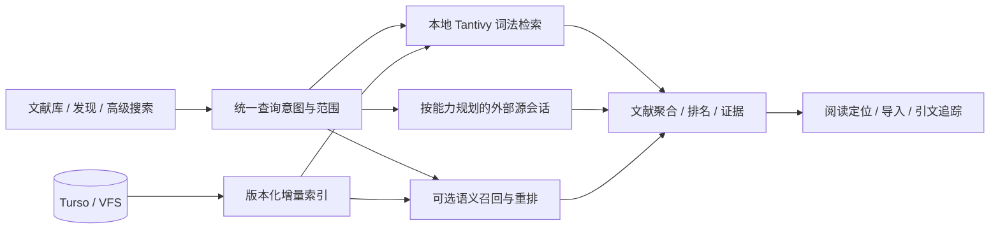

# 文献检索与 GUI 下一阶段计划

审查日期：2026-10-28。基线：HEAD `871890f`，同时审查 P3 发现工作区。本文是下一步设计与验收计划，不代表新功能已完成或重新通过测试。保留现有 [P0–P5 总体方案](literature-search-roadmap_zh.md)，本文对齐当前源码，作为后续任务排序依据。

## 目标与建议

把产品目标落实为四种任务：准确找到已知论文；在本地正文与批注中找到证据；跨源发现并可靠导入；沿引用关系持续追踪研究。

建议沿用 Rust + Turso + Tantivy + VFS + Zotero 对象模型，先完成 P3 数据源与发现闭环，再推进经评测证明有效的 P4 混合检索，最后实现 P5 引文、快照与订阅。性能、可访问性和跨平台验收贯穿各阶段。当前重点是已有系统的质量收口与增强，避免重复开发 P0–P2。

## 当前代码判断

| 能力 | 代码与当前状态 | 对后续工作的影响 |
| --- | --- | --- |
| 查询模型 | `bib-types/src/search.rs` 的 V2 AST 已支持字段、短语、嵌套 AND/OR/NOT、范围、排序和游标 | 继续以同一 AST 服务文本输入与图形构建器；不能因某源能力弱而静默删除条件 |
| 本地检索 | `bib-base/src/local_index.rs`、`search_analyzer.rs` 已有 Tantivy、BM25、标识符处理和科研文本分析 | 保留词法主干；真实领域相关性评价优先于直接更换引擎 |
| 一致性 | `search.rs`、`search_projection.rs` 已有 outbox、revision/token 和独立检索连接 | 存储写入与检索分离已有基础；重建与查询仍共用检索队列，维护期间搜索可能等待 |
| GUI / 阅读 | `bibliography.tsx` 及搜索组件已有精确筛选、分面、保存搜索、虚拟列表、证据和阅读跳转 | 继续完善任务闭环；缺少可靠映射时只提供真实文本定位，不补猜测页码 |
| 联邦发现 | `discovery_plan.rs`、`discovery_sessions.rs`、`discovery_merge.rs` 已有逐源会话、预算、取消、游标、强 ID 归并和来源信息 | P3 已有主体实现，应按源验收，而不是再新建一套搜索网关 |
| 导入 | `discovery_import.rs`、`discovery_acquisition.rs` 已有预览、指纹校验、逐项事务和全文获取队列 | 需要继续验收并发重复导入、已有人工元数据保留、失败恢复和容量行为 |
| 外部源 | PubMed / OpenAlex / arXiv / Crossref / S2 均已有发现适配和本地资格记录；S2 区分 bulk、relevance 与 lookup | P3 本地验收已完成；bioRxiv 保持 fetch-only 明示 |
| 语义基础 | `text-embedding` 已有 provider/model signature、Ollama 与向量基础设施 | 可评估复用；不能把已有向量工具视为文献语义检索已经接通，BM25 provider 也不等于语义模型 |

代码审查发现的重点风险：

1. `local_index::run_query` 以全部索引文档数作为 TopDocs 上限，再聚合和排序；返回 50 条不等于仅处理 50 条。宽词、纯 NOT、大集合和并发查询应单独压测。
2. 现有 P2 基准记载 100k 合成库纯 NOT 热 P95 约 202ms，但同类别首次约 1026ms；不能只报热缓存，也不能当作 GUI 或真实库指标。
3. 导入匹配的 `load_index` 按目标库扫描标识符；已有 P3 合成基准显示 100k 单项预览约 557ms P95。按需评估规范化标识符持久化索引及升级回填，保持同样的归并正确性。
4. Crossref 跨字段 OR 被转成交集的风险已修正，DOI AND/OR 分组求交也已有回归。后续来源继续逐一验证表达式翻译，不沿用扁平参数转换假定语义相同。最新证据见 [Crossref 资格记录](benchmarks/literature-search-p3-crossref-linux.json)。
5. `bibliography.tsx` 约 1194 行，发现视图也集中较多操作状态。功能稳定后按查询、列表、详情、导入任务提取职责，保持已有行为与跨工作区状态。
6. 现有路线图前半部分保留了早期阶段描述，与末尾执行记录存在时间差。后续阶段交付应同时更新能力矩阵、API 和验收记录。

上述基准来自仓库既有收据，本次未重跑性能或测试。参考 [P2 基准](benchmarks/literature-search-p2.md)、[P3 基准](benchmarks/literature-search-p3.md)。

## 产品对标与设计选择

| 参照 | 官方资料确认的能力 | 本项目采用的设计 |
| --- | --- | --- |
| [Zotero 搜索](https://www.zotero.org/support/searching) | 快速搜索范围、高级条件、持续更新的保存搜索、附件全文索引及状态 | 明确当前库/集合与内容范围；保存规则；索引覆盖、失败和维护状态可见 |
| [Zotero 去重](https://www.zotero.org/support/duplicate_detection) | 疑似重复检测、字段版本选择、合并保留集合和标签 | 强 ID 自动归并与弱相似人工审查分开；保留字段来源及人工编辑 |
| [Mendeley 搜索](https://static.mendeley.com/md-stitch/releases/live/03-searching-and-organizing-references.f40ca0f6.html) | 集合内搜索，桌面字段/短语/排除与摘要、PDF 范围控制；网页功能不同 | 提供少量清晰范围预设和高级入口；浏览器与 Tauri 共用后端语义，分别验收 |
| [JabRef 库内搜索](https://docs.jabref.org/finding-sorting-and-cleaning-entries/search) / [外部搜索](https://docs.jabref.org/collect/import-using-online-bibliographic-database) | 字段、精确匹配、布尔组合、历史，外部源选择与导入检查 | 面向专业用户保留字段语法与源原生查询；导入前检查目标库、重复与版本 |
| [Google Scholar](https://scholar.google.com/intl/en/scholar/help.html) | 相关性/时间排序、被引、相关论文、多个版本、全文入口和提醒 | 结果围绕阅读与扩展发现组织；Scholar 提供浏览器跳转入口，自动接入另行论证 |
| [PubMed](https://pubmed.ncbi.nlm.nih.gov/help/) | 专业字段/布尔/邻近查询、主题映射、检索解释及相似论文 | 公开实际执行查询和转换说明；通用检索与单源专业检索分开 |

不照搬各工具的符号语法；用户界面维持一套稳定语法，源适配负责翻译与能力声明。对能力有损的执行需要明确说明和用户主动选择，严格排除条件、标识符和范围不能丢弃。

## 架构与查询原则



- 统一用户意图与结果契约；本地查询和外部会话保留各自生命周期。
- 精确 ID 优先；普通词法检索与语义扩展显式区分。专业布尔模式的硬约束不得被模型覆盖。
- scope、权限、回收站过滤在结果交付前校验，筛选在计数与分页前生效。
- 归并以 DOI/PMID/来源 ID 等强证据为主；预印本与正式版建立关系，标题相似只提示。
- 来源原始分数不直接比较；先保留分源排名，再融合已召回候选。来源总数与已取得去重数分别显示。
- 证据绑定 item/attachment/annotation、内容版本及真实位置；附件替换后旧定位必须识别失效。
- 每源定义字段、操作符、筛选、排序、游标、认证、预算和错误类型。官方限制会变，资格测试与观测响应头共同约束执行。

特别注意：[OpenAlex 现行认证说明](https://help.openalex.org/api/authentication/)允许无 key 基本查询，但首批之后的 cursor paging 需要 key；[Crossref 官方说明](https://www.crossref.org/documentation/retrieve-metadata/rest-api/tips-for-using-the-crossref-rest-api/)要求正确使用游标、缓存和 429 退避，并提示索引变化会影响长时间遍历。源出错不能显示为零结果。

## GUI 设计

沿用三栏布局，保留“文献库 / 发现”两个入口及独立状态。

```text
左栏：库、集合、保存规则
中栏：搜索 [当前集合] [搜索内容范围] [高级]
      年份 / 类型 / 标签 / 全文 / 批注
      文献数 · 排序 · 表格/片段视图
      标题、作者、年份、来源或期刊
      真实命中片段 → 展开证据 → 打开原文
右栏：详情 / 命中证据 / 来源与版本 / 引文
发现：源进度与问题 → 已在库状态 → 选择版本 → 导入预览
```

具体交互：

1. 本地输入保留 250ms 防抖、Enter 立即执行和 IME 保护；外部搜索显式提交。默认只展示常用范围与条件。
2. 普通用户看到可用数据源、状态和清晰失败原因；执行参数、预算与原生语法放在“检索详情/专业模式”。专业模式由来源专用表单辅助，保留高级参数编辑。
3. 原生查询只绑定一个来源；按源保留草稿。条件不支持时在提交前提示，执行后仍保留实际查询和近似匹配说明。
4. 结果加载保留旧列表；新源到达时显示新结果提示，避免选中行移动。翻页、重新排序和刷新区分处理。
5. 一篇论文一行，展开附件或批注证据；全文获取与元数据导入分别展示状态，单项失败可重试。
6. 返回列表恢复查询、筛选、选择与滚动。桌面窄窗口和键盘操作作为固定验收场景；人工屏幕阅读器验证独立记录。

## 分阶段实施与交付

沿用现有 P0–P5 编号，不重新实施已完成阶段。建议每阶段形成一个可审查的功能交付与验收记录。

| 阶段 | 当前状态 | 后续工作 | 完成判据 |
| --- | --- | --- | --- |
| P0 契约与评价 | 已提交 `01452ed` | 补充真实语料、人工判断与业务任务基线 | 版本化查询集合、数据说明、指标及独立验收划分 |
| P1 本地词法引擎 | 已提交 `032a685` | 宽查询/并发/维护时延实测，按瓶颈优化聚合、过滤和分面 | 正确性不退化；冷/热/维护与资源指标分别报告 |
| P2 搜索与阅读 GUI | 已提交 `871890f` | PDF 映射覆盖、跨平台、人工可访问性；按需提取组件职责 | 集合检索到原文再返回的完整任务通过；缺失映射明确降级 |
| P3 多源发现 | 已实现并完成本地阶段验收 | 发布前补齐真实库及平台证据；阶段记录见资格收据 | 源能力和真实执行一致；快源独立交付；来源可追溯；导入幂等且保留人工数据 |
| P4 混合检索 | 未接入文献检索主链路 | 评测多语言模型、分块、向量增量更新、候选融合及有限重排 | 独立判断集证明主题检索收益；精确 ID、范围、排除和专业布尔无语义退化 |
| P5 持续发现 | 待实施 | 引文列表、相似论文、可复现快照、导出和增量订阅 | 快照可还原执行；订阅有持久水位、幂等去重、失败恢复和预算 |

P3 内部执行顺序：

1. 冻结现有工作区的变更边界、API 与能力矩阵，记录已通过和待执行的资格项目。
2. 收口 Crossref 查询编译、DOI 组合、响应验证、分页、共享限流和凭据脱敏。
3. 将 S2 接入 discovery trait，分别验证搜索端点的语义、分页与限制，不复用旧转换假定能力相同。
4. 完成受控 HTTP 的超时、429、错误正文、游标异常、取消和重复记录测试；运行 GUI 首批/增量/分页/容量/导入回归。
5. 运行真实领域小样本，人工核对召回、版本与来源冲突；单独报告上游线上观察和确定性测试结果。
6. 同步 API、路线图、基准与发布门槛，完成阶段交付。未通过资格的来源保持不可用或实验状态。

P4 内部执行顺序：先评价集，再模型与分块对比，再持久向量索引与更新，最后 GUI 开关。向量键包含对象身份、内容 revision、分块版本和模型 signature；模型更换须重建。先从标题/摘要及可靠 SDT 段落开始，评测后决定近似索引方案。记录离线/远程执行、数据发送范围、许可证、内存与延迟。

P5 内部执行顺序：引用/被引列表 → 相似论文 → 执行快照与 RIS/BibTeX/JSON 导出 → 订阅。动态保存搜索保存规则，快照保存某次执行与已取得结果；快照记录截断和部分失败，不宣称外部索引未来可完全重放。订阅用更新/索引时间水位与重叠窗口，避免仅按发表日期漏掉回填数据；通知渠道单独配置。

## 验收与优先级

先建立 100–200 条人工判断查询，覆盖已知论文、主题检索、中英文、科研符号、复杂布尔、正文证据与跨源版本。人工标注作为相关性依据，合成数据用于规模和边界；调参与验收集分开。跨源完整召回不可知时，应把 Recall@50 标为相对于已标注候选池的召回。

建议验收目标，均不是本次实测结果：

- 已知规范 ID：测试集合内正确记录 Top-1 100%，冲突身份不误合并。
- 本地性能：指定参考硬件和并发，10k 热服务端 P95 ≤150ms、GUI 可见结果 ≤300ms；100k 热服务端 P95 ≤400ms。另报首次、冷缓存、维护并行和资源占用。
- 外部交付：受控测试中快源不等待慢源；全流程观测首批、完成、取消时延与失败率。线上上游时延单独统计，不作供应商硬承诺。
- 证据：具备可靠映射的验收语料正确打开对应对象/位置；未知位置不得编造。
- P4 质量：争取主题查询 nDCG@10 相对词法基线提高至少 10%，报告各组退化和资源成本；不达标则保持实验开关。
- 一致性：修改、删除、附件替换、重启、重建后计数和权限正确；取消后无迟到覆盖；重复导入不重复创建。
- 平台：浏览器和真实 Linux/macOS/Windows Tauri 分别记录结果，模拟桥接不能代替实机；人工可访问性未执行时明确保留门槛。

后续优先级：P4 真实质量评价与混合检索 → 首次宽查询及端到端体验 → P5 引文与持续追踪。第一版可发布范围继续聚焦已实现的可靠库内检索和阅读；发现、混合检索与订阅各自独立启用、验收和回退。
