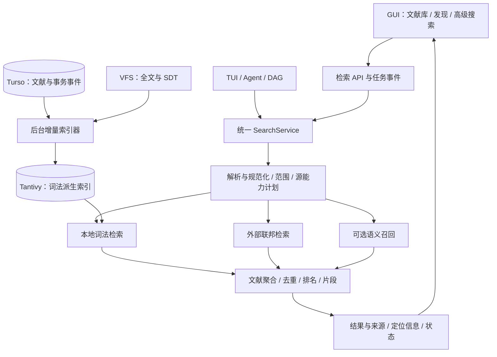

# 文献检索引擎与 GUI 优化实施方案

日期：2026-10-27。依据当前工作区源码和官方产品资料制定；工作区已有大量未提交的文献管理、集合和阅读器改动，本方案以这些改动后的代码为依据，不覆盖现有工作。本文是设计与排期建议，不代表已经完成实现或性能验证。

## 1. 建议与产品目标

把“顶级检索”定义为四项可验证的能力：**找得准、覆盖全、知道为什么命中、点一下到达原文**。产品应同时服务三类任务：

1. 已知文献查找：输入作者、标题片段、DOI、PMID，迅速找到库内条目或可导入的外部记录。
2. 库内研究：搜索元数据、全文、笔记与批注，组合条件、保存动态搜索，并直接跳转到证据位置。
3. 外部发现：跨数据库检索、去重、比较版本、追踪引用、批量导入，保留原始来源和检索过程。

总体建议：保留现有 Rust、Turso、VFS 和 Zotero item 模型；增加统一检索服务，优先验证嵌入式 Tantivy 作为词法索引；逐步加入联邦搜索、语义召回和重排。先交付可靠的词法搜索与阅读闭环，再用评价集决定是否上线语义功能。

## 2. 当前代码：已有基础与具体缺口

| 层面 | 当前实现与代码入口 | 结论 |
| --- | --- | --- |
| 对象与存储 | `crates/bib-base/src/zotero_model.rs`、`docs/zotero-alignment.md` | 已有 libraries/items、creator/tag、父子附件、全文状态、批注和 VFS 定位。可以沿用，无须重建文献对象模型。兼容 articles/fulltexts 仍在参与查询。 |
| 本地索引 | `crates/bib-base/src/bib_base.rs`：`sync_search_index`、`tokenize`、`search_articles` | 已有事务内维护的 `searchTerms` 倒排表，覆盖标题、摘要、全部附件全文和批注。并非纯 LIKE 搜索；`library_tools.rs` 中 LIKE 描述已落后于实现。 |
| 集合搜索 | `crates/bib-base/src/collections.rs`：`query_collection_articles` | 已在数据库中先应用集合/子集合范围及词法条件，再计数与分页；不能将其误判为“仅在前 500 条中前端过滤”。已有超过 500 条的回归测试。 |
| 查询表达 | `crates/bib-types/src/query.rs`：`StructuredSearch` | 已有关键词、标题、作者、MeSH、期刊、类型、机构与年份；模型是扁平条件，无法完整表示嵌套布尔树、短语、邻近、局部搜索范围。 |
| 外部源 | `crates/bib-base/src/query.rs`、`shared.rs` | 当前共享网关注册 PubMed、arXiv、bioRxiv、OpenAlex、Crossref、Semantic Scholar。bioRxiv 适配器仅能按标识符获取，关键词搜索返回空批次；应明确标识能力。Europe PMC、Embase SDK 的存在不等于已接入该联邦网关。 |
| 外部 API | `crates/api-server/src/bib.rs`：`search_external` | `/search/external` 当前仅把字符串放入单个 keyword，支持选择源；没有暴露完整结构化查询、连续翻页和融合后的文献级结果。 |
| 聚合行为 | `LiteratureGateway::search_subset` | 已并发请求并逐源保留错误，但 `join_all` 等全部结束后返回；此层没有跨源去重、全局排名、源游标或流式首批交付。已有 HTTP 超时配置，问题是缺少查询级预算与逐源增量交付。 |
| GUI | `apps/gui/src/features/bibliography.tsx` | 已有三栏、集合树、搜索提交、500 条分批加载、附件状态、批量选择和请求序号防旧响应覆盖。尚未展示命中片段、过滤面板、高级构建器、保存搜索、外部发现工作区。列表使用普通 map，继续加载会持续增加 DOM。 |
| 阅读闭环 | `apps/gui/src/pdf-reader.ts`、`reading-mode.ts`、`docs/zotero-reading-mode.md` | 已有 PDF 搜索及 SDT 阅读和映射基础，可以扩展跨文献搜索命中的定位；当前 SearchHit 不携带附件/段落/页码。 |
| 多端 | `apps/autonomics`、`apps/gui`、`crates/api-server/frontend` | 同时存在 TUI、主 React GUI 和服务器前端。检索语义必须放后端共享；GUI 优先主 React 实现，其他端明确兼容范围。 |

### 优先修正的正确性问题

- **重复词漏检**：`tokenize` 保留重复词，两条本地查询路径使用 `COUNT(DISTINCT term) = terms.len()`。例如 `GWAS GWAS` 的不同词数为 1，要求值却为 2，无法命中。先统一查询规范化，补两条路径的回归测试；短语中的重复词则必须保留其位置语义。
- **检索字段不完整**：现有索引构建实际只写 title、abstract、fulltext、annotation；普通作者、期刊、年份、标识符与文献关键词没有完整纳入对应字段搜索。仅在批注 tag 文本中偶然命中不能替代元数据字段检索。
- **位置与相关性缺失**：倒排表主键是 `(term, anchorKey, field)`，不保存词频与词位置，无法提供可靠的短语、邻近和 BM25 相关性。当前 score 只是 0–3 字段优先级。
- **命中附件与片段脱节**：索引覆盖所有附件，但 `search_articles` 读取的片段正文来自兼容 `fulltexts` 的首选附件。非首选附件命中后，可能只返回标题作为片段，也不能打开命中的附件。
- **多词片段不可靠**：匹配按词的交集执行，`extract_snippet` 却寻找完整原始查询子串；词分散在正文中时会退回标题。
- **结果排序不统一**：`search_articles` 与集合查询拥有不同排序细节；前者缺少明确的最终唯一键排序，需要稳定分页。
- **索引更新成本**：任一索引同步先删整篇再重建所有附件与批注词项；批量插入随全文词数生成参数，需要验证数据库参数边界。启动版本变化还会逐篇重建，需改成可恢复后台任务。

以上来自静态代码分析；尚未运行专项复现、性能基准或浏览器体验测试。

## 3. 对标：应吸收的能力

| 对标对象 | 官方资料确认的能力 | 对本项目的取舍 |
| --- | --- | --- |
| [Zotero 搜索](https://www.zotero.org/support/searching) | 快速搜索范围、高级条件、动态保存搜索、附件全文索引及重建 | 建立清晰的搜索范围和索引可见性；原生支持嵌套布尔表达式，并增强命中片段和阅读定位。 |
| [Mendeley 搜索与组织](https://static.mendeley.com/md-stitch/releases/live/03-searching-and-organizing-references.f40ca0f6.html) | 当前集合内搜索，title/author/year/abstract 字段搜索 | 搜索框显示当前集合与递归范围，面向熟练用户提供字段语法，与图形条件构建器共享语义。 |
| [Google Scholar 搜索帮助](https://scholar.google.com/intl/en/scholar/help.html) | 相关性与时间排序、被引、相关文献、多版本、全文入口、提醒 | 外部发现页面应围绕“相关性—证据—版本—导入”组织；Google Scholar 本阶段作为外部跳转入口，不列为已具备的 SDK 数据源。 |
| [Semantic Scholar 产品](https://webflow.semanticscholar.org/product) | 文献筛选、语境化阅读、论文与引用关系 API | 复用已有 S2 客户端，增加相似文献、前后向引文探索；图谱可视化后置，先做好引用列表。 |
| [PubMed 用户指南](https://pubmed.ncbi.nlm.nih.gov/help/) | 字段检索、主题映射、Search Details | 保存每个源实际执行的查询，显示条件是否被支持；专业检索提供原生语法模式，避免自动改写破坏可复现性。 |
| [OpenAlex API](https://help.openalex.org/api/) | 检索、过滤、排序、聚合、分页等独立能力 | 建立源能力描述、真实游标、筛选兼容性和配额状态。具体能力与预算以接入时官方接口及契约测试为准。 |

这些产品共同说明，搜索质量同时取决于查询控制、结果组织和后续阅读操作。语义搜索是增益模块，精确标识符、专业布尔检索与证据定位必须独立可靠。

## 4. 技术架构



### 4.1 查询契约

在 `bib-types` 新增 `SearchRequestV2`、`SearchExpr`、`SearchResponseV2`，逐步替代扁平模型的局限。旧接口保留适配层。统一的是用户意图、契约和状态，而非假定所有源拥有相同的搜索能力。

- `SearchExpr`：term、phrase、and、or、not、field、range；邻近查询后续按后端能力启用。
- `scope`：library、collection、include_descendants、unfiled、local/external；父条目/附件/批注匹配策略显式化。
- `filters`：作者、年份、期刊、标签、文献类型、有全文、有批注、提取/索引状态；只对具备此字段的源执行并返回能力说明。
- `sort`、`cursor`、`page_size`、`sources`、`mode`、`deadline`；语法错误返回具体位置与修改提示。
- 已知 DOI/PMID/arXiv 等优先做规范化标识符解析；避免标点切词破坏精确查找。
- 默认普通搜索维持当前“多词 AND”的兼容行为；图形高级搜索与文本输入均生成同一 AST。`NOT` 必须显式定义一元排除和作用域，不沿用扁平 BoolOp 的歧义。
- 普通精确检索、可选概念扩展、语义模式明确区分；不静默将中文问题翻译后当成原始精确查询。
- 子对象语义：`fulltext:(A AND B)` 默认要求同一附件内满足；顶层 Everything 可允许父子对象合并满足，并返回各自证据。短语绝不能跨附件或跨独立段落拼接。
- 外部源不能表达的条件返回 unsupported/approximate 说明；专业模式禁止静默删除条件。原生查询绑定单一数据源。

### 4.2 本地词法引擎选型

优先对嵌入式 [Tantivy](https://docs.rs/tantivy/latest/tantivy/) 做原型验证：与 Rust 技术栈一致，提供带词频/位置的索引、查询解析与可定制分词。应用自己的 AST 负责用户语法，不直接把引擎原生语法当作产品接口。

暂不引入必须单独运维的 Elasticsearch/OpenSearch 服务；若未来出现组织级超大共享库再评估。FTS5 可以作为备选，但项目使用的是 `turso = 0.7.2`，不能从“SQLite 兼容”推断目标运行时已具备所需 FTS 扩展；应通过最小可运行验证后决定。

两级检索对象：文献级元数据用于排序、筛选和计数；附件段落/批注级文本用于证据召回。以 item/attachment/annotation key 为稳定身份，article_id 仅作为兼容映射。原型须比较“一条目一文档”和“独立证据文档 + 文献聚合”的成本，明确文献总数与片段总数不能混淆。

建议字段：标题、作者标准化形式与原文、期刊、标识符、年份、摘要、标签、批注、附件文本、section、page、SDT block、语言、对象版本。标题精确/短语与标识符优先，正文使用 BM25；作者、标签用独立规则，不依赖长正文得分。按可用字段逐步迁移，禁止从猜测补齐缺失元数据。

中文分词和英文词形分析分别验证；保留精确子字段处理 `APOE`、`IL-6`、`p53`、`α-synuclein` 等科研符号。拼写建议与同义词扩展先显式提示，避免模糊匹配改变基因或药物名称含义。

### 4.3 索引一致性与恢复

引入外部索引后，不能继续声称数据库与索引天然同事务。文献更新事务内写入 outbox，后台 worker 按对象 key 和 revision 幂等更新派生索引，提交索引后再确认消费。崩溃后重复处理安全，旧版本事件不能覆盖新对象。

- 删除、附件替换、批注修改、收藏范围变化都有对应事件；按对象粒度更新，避免重建整篇全部附件。
- 显示 source_revision/indexed_revision、覆盖率、积压和失败；不能以“提取完成”冒充“已可检索”。
- 初次全量构建：数据库一致性快照/水位 + 后续事件回放；新旧索引双写或双消费，校验后切换 generation。保留上一代以便回退。
- 查询 token 绑定 query hash、scope、排序和 index generation；游标过期返回可理解的重查提示。翻页采用稳定文献级排序键。
- 不将磁盘索引路径当作 VFS 内容地址使用；明确桌面与服务端的持久卷目录、单 writer 锁和关闭流程。索引可以从数据库/VFS 重建。
- 权限、回收站与删除过滤在返回结果前基于当前数据再次检查，避免索引暂时落后时泄露或显示已删除对象。

### 4.4 多源联邦与去重

保留 `LiteratureSource`，增加 capability、search page、native query、source cursor 和结构化状态。优先 PubMed + OpenAlex；再完善 Crossref、S2、arXiv。Europe PMC 后续接入，Embase 根据授权与 SDK 实际能力单独排期；bioRxiv 列为 fetch-only，通过支持预印本检索的源发现候选。

- 按源设置 deadline、限流、重试和缓存；尊重 Retry-After，将 timeout/auth_required/rate_limited/unsupported 与真实零结果区分。
- 通过异步完成队列逐源交付首批结果，支持取消、单源重试。新增 SSE 方案须同时设计浏览器认证及 Tauri 事件/流式转发，不能只在 Web fetch 中可用。
- 同一论文按标准化 DOI、PMID、源 ID 等强证据归并，保留全部来源与字段 provenance；来源字段冲突可查看，不用“最后到达者覆盖”。
- 仅标题相似的记录先标记疑似重复；预印本与正式出版物建版本关系，避免无条件合并。
- 先提供各源排名视图与候选集 RRF 融合；不直接比较不同源的原始分数，也不把引用量作为默认主排序。RRF 仅针对已召回候选，不宣称全库最优排名。
- 多源原始 total 分别显示，融合后只给已取得候选的去重数量；没有证明时不显示“全网精确去重总数”。
- 会话保存源游标和已交付 ID。增量到达时显示“有新结果”或追加到候选区，避免用户正在操作的行不断跳动。
- 导入幂等，显示已在库、版本关联、目标集合、元数据差异和逐项成功/失败；复用现有写入、全文获取与提取链路。

OpenAlex 当前官方资料对身份、游标和配额有专门要求，不能只依赖源码中“可选 key/free tier”的注释；上线前逐源校验能力与配额，见[认证说明](https://help.openalex.org/api/authentication/)。

### 4.5 语义检索与阅读定位

在词法基线达标后加入标题/摘要和 SDT 段落向量召回，评测多语言模型；先做小规模离线选型，不预定模型或向量库。向量记录与对象 key、revision、分块版本和模型版本绑定；模型切换独立重建。

候选融合采用词法 + 语义 RRF，可选对有限候选重排，再聚合为文献。精确标识符和高级布尔模式不由语义模型覆盖。正文段落应过滤重复页眉/参考文献噪声，并保留段落与原文映射；自然语言回答若后续加入，引用必须来自可打开的实际片段。

结果返回 `item_key`、`attachment_key`、可选 `annotation_key`、`matched_field`、片段与高亮区间、page/SDT block/text offset、content revision 和原文链接。片段按位置从真实命中文本生成，渲染使用文本与范围，避免插入未清洗 HTML。无可靠页码或扫描件映射时显示章节/文本定位能力，不能编造页码。附件变更后旧定位应失效并尝试重新定位。

## 5. GUI 配套设计

延续三栏布局，增加“文献库 / 发现”两个工作入口，分别保留搜索状态；需要时可以展示外部补充结果，但不能把未导入记录混成库内条目。

```text
集合 / 保存搜索       搜索框 [当前集合 ▾] [范围 ▾] [高级] [保存]
                    年份 · 类型 · 标签 · 全文 · 批注   清除条件
                    128 篇文献 / 342 处命中        相关性 ▾
                    标题 / 作者 / 年份 / 期刊 / 附件与索引状态
                    摘要：…高亮词…                展开 3 处命中
                    附件 B · 第 7 页 · Methods    打开命中位置
                    ────────────────────────────────────
                    下一条文献 …                  右栏详情/证据预览
```

优先变化：

1. 搜索框：库内默认 200–300ms 防抖，并保留 Enter 立即搜索；中文 IME 组合期间不发起查询。外部检索默认显式提交。提供清空、历史、字段提示、Ctrl/Cmd+F、Escape 与上下选择。
2. 搜索范围：显示“当前集合/含子集合/全部文献”，提供标题作者年份、元数据与笔记、全部内容三档；搜索模式记忆与快捷键可发现。
3. 高级条件：支持可嵌套 AND/OR/NOT、字段和范围；文本语法与条件树同步，不能静默丢掉无法可视化的原生查询。保存搜索存 AST 和版本，动态执行；与静态收藏集合区分。
4. 结果：浏览时紧凑表格，搜索时可切换带片段列表；排序、可配置列、匹配字段、多附件命中、批注命中一目了然。展开证据、直接打开命中，不依赖先打开详情再手工搜索。
5. 外部发现：选择数据源、年份/类型等可用条件；展示源进度和失败原因、查询详情、全文可用性、已在库状态、批量导入；相关文献与引文作为右栏页签。
6. 性能与状态：列表虚拟化，分页初始建议 50–100 条，经实测调整；集合和健康信息独立缓存，避免每次翻页都先请求它们。保留已展示结果并提示刷新，增加 AbortSignal/查询任务取消。
7. 交互可靠性：列表已有 requestSequence 机制应沿用；详情请求也要加竞态保护。列表键盘导航、复选框、多选、虚拟行和屏幕阅读器焦点一起验证。浏览器与 Tauri 取消机制分别实现并验收。
8. 可诊断状态：区分“没有符合条件的文献”“只完成部分来源”“正文尚未索引”“索引失败”“语法错误”。索引维护入口支持重试单附件、后台重建和进度查看。

建议拆分 `bibliography.tsx`：`useBibSearch`、`SearchToolbar`、`AdvancedSearchBuilder`、`SearchResults`、`SearchHitPreview`、`DiscoveryView`、`IndexStatus`。URL/路由保存查询和筛选，返回列表时恢复排序、滚动和选择；不将 API 密钥放入 URL 或前端状态。

## 6. 分阶段交付与依赖

下面按单名全职工程师的有效工程工作日粗估，需在 P0 后重估；不包含等待外部授权及大规模人工相关性标注。P0–P2 是第一个可发布闭环，后续按收益推进。

| 阶段 | 预计 | 主要交付 | 进入下一阶段的验收门槛 |
| --- | --- | --- | --- |
| P0 基线与契约 | 3–5 日 | 搜索场景与判断集、重复词/片段问题复现、两条查询路径对齐、API V2 与 AST 草案、Tantivy/Turso 原型及 ADR | 确认选型、记录当前质量与性能；正确性修复覆盖两条本地路径，明确回滚办法。 |
| P1 本地引擎 | 8–12 日 | 字段索引、精确 ID、AST 执行、位置与片段、outbox、后台构建、稳定文献级分页、旧接口适配 | 多附件定位正确；更新/删除/崩溃恢复通过；10k 与 100k 条数据基准完成。 |
| P2 GUI 搜索闭环 | 6–10 日 | 范围、过滤、搜索结果、虚拟列表、高级搜索、动态保存搜索、点击定位、索引状态 | 浏览器/Tauri 场景可完成“输入—筛选—保存—打开证据”；无过期响应覆盖；可访问性检查通过。 |
| P3 外部发现 | 8–12 日 | 源能力与游标、PubMed/OpenAlex 优先增量交付、去重和来源、导入、原生查询详情；其他已接源逐一验收 | 慢源/失败源不阻塞可用首批；真实分页、幂等导入、不同版本不误合并。 |
| P4 语义增强 | 6–10 日 | 分块/模型比较、增量向量索引、混合召回、有限重排、中英查询评测 | 独立测试集较词法基线有收益，精确查找和布尔约束不退化；资源成本达标。 |
| P5 探索与追踪 | 5–8 日 | 引文/相关文献、检索快照、可复现导出、订阅任务与新文献提醒；图谱按实际需要增加 | 可追溯源查询、时间和版本；提醒只报告新增/更新并去重。 |

合计约 36–57 个工程工作日，另计综合发布缓冲；首个本地检索与 GUI 闭环约 17–27 日。检索快照保存实际结果及来源，动态保存搜索只保存规则，两者分别实现。

### 建议拆分为可审查的变更

1. 正确性回归与描述修正：重复词、稳定排序、命中片段、多附件结果身份。
2. `bib-types` V2 查询/结果契约与 parser；兼容适配，不一次性替换所有 SDK。
3. 本地索引引擎原型、ADR 和基准；随后 outbox、索引 worker 与迁移。
4. `SearchService` 及本地 API，接入 Agent/TUI/集合查询，消除两套独立语义。
5. GUI 数据 hook、虚拟列表、范围/过滤/片段/定位。
6. 高级构建器和保存搜索的模型、API 与侧栏入口。
7. 联邦搜索任务、逐源状态、游标、去重和导入；同时打通 Tauri 传输。
8. 语义与引文功能分别以 feature flag 交付，基于评价结果决定默认开启。

## 7. 质量评价与发布门槛

先建立 100–200 条查询的判断集，覆盖已知文献、作者/年份、短语与排除、科研符号、中英文、分散多词、多附件、批注、集合递归、外部跨源重复与版本等；独立划分调参与验收集。人工判断作为主依据，合成数据用于边界与规模测试。

建议目标，均为待验证的验收标准：

- 已知规范标识符查询：正确记录 Top-1 100%；重复词、大小写和标点的约定语义通过回归用例。
- 主题搜索：记录 nDCG@10、Recall@50、MRR；先度量现状，P1 不能降低精确检索正确率，P4 在概念查询上争取 nDCG@10 相对词法基线上升至少 10%，并检查各类查询退化。
- 指定参考硬件、真实文本长度分布和并发条件后，在 10k 文献库争取本地服务端热查询 P95 ≤150ms、GUI 可见结果 ≤300ms；100k 库争取服务端 P95 ≤400ms。另报冷启动、冷缓存、后台索引并行时延和内存，不能只报最好值。
- 外部搜索统计首批返回、全部完成、取消和失败率；以可控 mock 验证快源完成即交付、慢源不阻塞。真实网络时延作为观测指标，不能对供应商响应时间作硬保证。
- 片段必须对应实际命中对象，定位数据带内容版本；有可靠映射的测试语料要求全部正确打开对应附件/段落。
- 修改、删除、崩溃恢复、索引重建/切换后，结果和计数一致；索引延迟可见。集合过滤在分页前生效，父文献总数不能重复计算。
- 虚拟列表大规模滚动、键盘选择、批量导入、切换集合、快速输入/切换详情在浏览器及 Tauri 均无状态串扰。

验证组织：Rust 单元/集成测试负责查询语义、数据库与 worker；SDK 契约测试负责查询翻译、分页与错误；GUI Playwright 负责端到端任务。现有 `nested_collections.rs`、`collections_and_fulltext.rs`、API 多附件测试和 `lit_search_e2e.rs` 是起点。CI 使用稳定的本地夹具/mock，真实外部 API 测试单独运行。

## 8. 发布与当前边界

- 以 feature flag 控制新引擎、V2 API、外部发现和语义功能；小库和大库分别灰度。
- 不在同一变更中同时重写对象存储、替换全文提取链路和引入搜索索引；沿用当前 Zotero SDT 与 VFS 的成果。
- 若原型在分面计数、文献聚合或索引内存上不达标，先缩小证据索引/分块策略，再比较其他后端；不在未测量前承诺最终容量。
- 本轮没有修改实现、运行测试或请求真实文献搜索 API。实施前先固定一份可测试的工作区快照；文档中的函数名比行号更适合作为当前持续开发中的定位依据。
