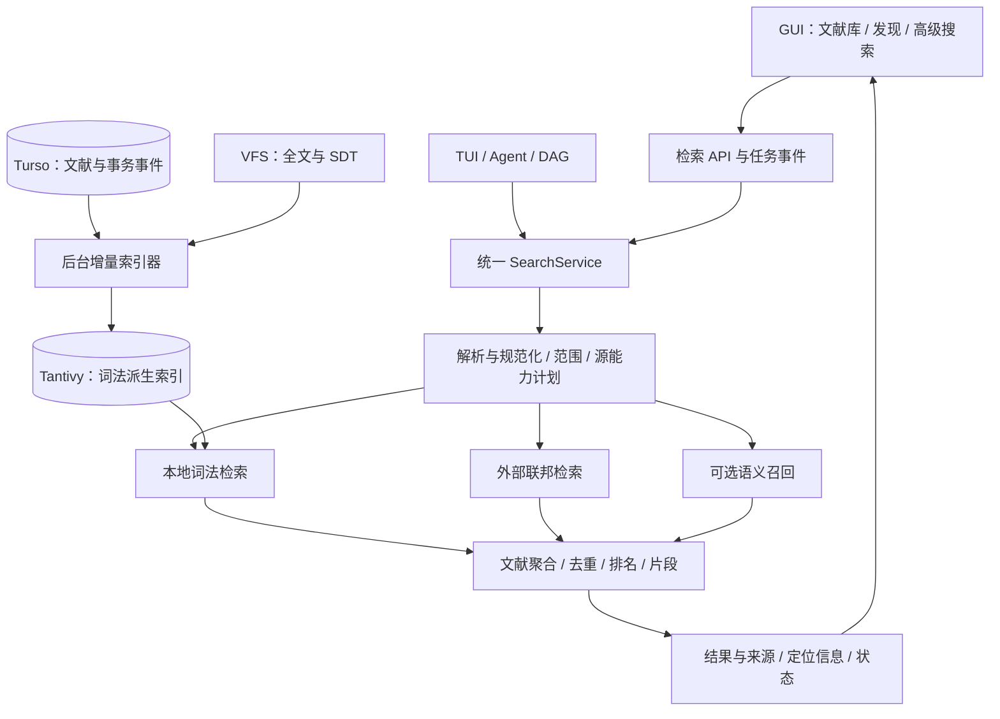

# 文献检索引擎与 GUI 优化实施方案

P4 精确排序补充（2026-10-28）：借用 Top-K 和最多 4 线程的逐块扫描已验证，保持块内 f64 累加与并列规则。冻结 release 合成测量中，100k 篇/700k 块/1024 维宽范围排序 P95 约 629→340ms，中位数约 515→240ms，所比结果/评分逐位一致；窄范围存在波动，完整分布如实保留。这里只测排序，不能代替端到端性能或持续写入验收。最终源码索引/API、单 CPU 回退与严格 Clippy 已通过，先前并行版本另有 419 项回归。见 [精确排序资格](benchmarks/literature-search-p4-exact-rank-linux.json)及[交付核对](literature-search-delivery-audit_zh.md)。

P5 原生验证补充（2026-10-28）：实际 Linux Tauri/WebKitGTK 的引文/被引、两种推荐范围、精确 ID 重新获取后导入、不可变快照及系统保存对话框导出、订阅检查/目标集合导入/编辑/暂停恢复/额度、切换工作区与显式取消、页面重载均通过，严格 Clippy 通过。来源使用独立本地 fixture，未将其当作公网来源或打包应用资格；最终阶段隔离和其余门槛仍待完成。见 [原生资格](benchmarks/literature-search-p5-native-linux.json)。

当前执行（2026-10-28）：有界清理版本的独立构建/360 项后端及严格 Clippy、浏览器/模拟桥接、真实 Qwen 功能复核均通过。100k 篇/200k 附件/700k 块完整功能运行成功结束，含写入收敛、非首选附件原始字节与证据、删除/替换及旧游标失效，最终修订 500073、700k 块、无错误。共享主机宽查询热 P95 约 3.25 秒、四客户端约 9.04 秒；40 次写入是短突发，不能当作长期可用性验收。性能、最终原生/恢复与阶段隔离仍需收口，P4/P5 均未提交。见 [有界清理资格](benchmarks/literature-search-p4-bounded-cleanup-linux.json)。

P5 当前增量：自动调度、持久额度等待、执行历史和 API 已实现；50 项后端专项及 4 项 HTTP 用例通过（含独立连接资源恢复）；严格 Clippy 通过，Crossref 兼容性修改前的合并工作树完整后端回归 461 项通过，0 失败、0 忽略（含 3 项文档用例）；阶段隔离资格仍需收口。订阅 GUI 已接入并通过浏览器/模拟桥接、标识核验、引文/发现回归、类型检查和 GUI 构建，见 [GUI 资格](benchmarks/literature-search-p5-subscriptions-gui-linux.json)。Crossref offset/游标兼容性与失效游标后台重放已验证，83 项专项及公开 Crossref 小范围请求通过；修改后的完整后端回归 468 项通过、0 失败、0 忽略，见 [来源资格](benchmarks/literature-search-p5-source-compat-linux.json)。真实 SIGKILL 接管、旧进程恢复后的请求隔离、关闭数据库家族备份恢复和跨进程额度等待验证均通过，见 [进程恢复资格](benchmarks/literature-search-p5-subscription-recovery-linux.json)。实际原生 GUI 已通过，见文首原生资格；其余来源范围及最终阶段隔离回归仍待完成，调度/API 见 [资格记录](benchmarks/literature-search-p5-scheduler-linux.json)。
上一轮状态（2026-10-28）：P0–P3 已提交，P4/P5 均未提交。全量 NeuCLIRTech 中文独立评价已完成：395,927 篇、110 查询，冻结 Qwen 配置的 nDCG@20 为 0.446672，词法为 0.300555，相对提高 48.62%；18 查询退化，混合后端单次查询 P95 约 4.95 秒，不能作为普遍质量或性能承诺。详见 [中文质量收据](benchmarks/literature-search-p4-neuclir-hybrid-linux.json)。最新 100k 附件恢复运行已终止：200k 附件导入/验证完成，700k 块初次就绪约 873.9 秒，但后续验证报 `database is locked`，未通过完整容量验收，确切失败操作仍在定位。P4 分批复制版本的隔离后端 354 项通过；索引选择修正后的 27 项专项回归及严格 Clippy 通过。P5 引文探索、确认导入和不可变搜索快照已接入并分别测试；订阅已有独立持久规则、租约、页面原子存储与窗口规划，调度/API/GUI 尚未实现，见 [订阅设计](literature-search-p5-subscriptions-design_zh.md)。后文旧轮次记录保留历史语境，当前状态以文首记录为准。

锁错误排查：独立副本中，原单条 SQL 复制 700k 绑定约 128.2 秒后复现相同 Busy 错误。现已改为每批 2,048 条、修订检查、续租和原子提交，并明确使用现有主键索引；Turso 默认给有界范围复制选择文章索引，会每批扫描整代。实际 700k 分批复制已完成，全部绑定内容 SHA-256 一致且旧发布头不变；调试构建耗时约 398.9 秒，期间存在其他构建/文件复制，不作生产性能或受控提速结论。100 篇端到端验证通过，100k 完整服务复测已终止：初始索引、宽/窄/四客户端测量和增量绑定复制完成，但持续写入后的发布阶段再次报 `database is locked`；初次 700k 块就绪约 1,531.9 秒，宽查询热 P95 约 1.58 秒，四客户端约 6.48 秒，均是共享主机观测且尚无完整成功收据。独立副本中，700k 绑定的未引用旧代级联删除也在约 159.2 秒后复现 Busy；真实发布阶段仍需细分定位，有界旧代/向量清理及该规模性能仍待处理，不能宣布容量通过。见 [故障与修复资格](benchmarks/literature-search-p4-binding-copy-linux.json)。

日期：2026-10-28。P4 长任务继续运行，P5 先并行开发未接线的独立快照存储/导出原型；两阶段仍各自验收与提交。本方案保留原始设计与阶段记录；P0–P3 的实现和本地验收已完成，最新状态以末尾执行记录与资格收据为准。跨平台、人工可访问性和真实库质量分别作为发布门槛，不能用本地测试替代。执行目标为按 P0–P5 自主实现，每阶段一个提交。

P4 正在实现：真实 Qwen/BGE-M3、分块、有限重排与冻结 RRF 的英文候选实验已完成；300 条独立 test 的 nDCG@10 相对生产词法 OR 提高 25.30%。该分数只涵盖诊断检索。另已接通持久增量向量、配置/后台服务、V2 查询/证据/导出及 GUI 主题检索、配置和规则恢复；主链路测试、32 篇真实探针、浏览器/模拟桥接与实际 Linux Qwen WebView 各有独立收据。重建/修复/暂停/恢复与 SIGKILL 接管已验证；完整容量/恢复与中文真实质量尚未完成，P4 尚未提交。见 [P4 评价与收据](benchmarks/literature-search-p4.md)、[实施细化](literature-search-p4-design_zh.md)。前半部能力表保留原始 P0–P2 审查状态，后续状态以本段、执行记录与资格收据为准。

## 1. 建议与产品目标

资源阶段补充：已接入持久预算、占用显示、稳定等待及预算调整后的修复续算，真实 Qwen 验证 16 个已提交向量保留、仅补算 4 个，暂停状态也保留；长设置页固定标题和保存操作。当前 349 项全量后端/可选提取测试通过，严格 Clippy、实际 Linux 原生与隔离 GUI 构建通过，见 [资源记录](benchmarks/literature-search-p4-resource-limits-linux.json)。磁盘额度为协作检查，不是 OS 硬配额。多附件规模、持续写入、长时间批次和中文质量仍待完成，P4 保持未提交。

最新执行补充：10k/100k 真实 HTTP 和浏览器容量、ext4 文件缓存建议清理后的启动观察、300 条英文词法排名回归，以及排除其他修改的 GUI 生产构建已有资格记录，见 [P4 新增验收](benchmarks/literature-search-p4.md#http浏览器与磁盘启动复核)。后续分批读取已将 100k 磁盘配置至就绪单次约 16.1→5.94 秒、进程至首结果约 20.5→10.6 秒；热 HTTP P95 仍约 415ms，峰值 RSS 增加约 31MiB，见 [启动对照](benchmarks/literature-search-p4-startup-linux.json)。真实 BGE 长摘要及 Qwen/Linux 原生高级配置亦已验证，不能代替大规模全文或质量验收。人工判断候选池与导出工具已完成，但没有真实中文等级。P4 仍在进行，P5 排期不变；最新工作依赖见 [下一阶段计划](literature-search-next-plan_zh.md)。

把“顶级检索”定义为四项可验证的能力：**找得准、覆盖全、知道为什么命中、点一下到达原文**。产品应同时服务三类任务：

1. 已知文献查找：输入作者、标题片段、DOI、PMID，迅速找到库内条目或可导入的外部记录。
2. 库内研究：搜索元数据、全文、笔记与批注，组合条件、保存动态搜索，并直接跳转到证据位置。
3. 外部发现：跨数据库检索、去重、比较版本、追踪引用、批量导入，保留原始来源和检索过程。

总体建议：保留现有 Rust、Turso、VFS 和 Zotero item 模型；增加统一检索服务，已验证 Turso 原生 FTS 并在 P1 采用独立 Tantivy；逐步加入联邦搜索、语义召回和重排。先交付可靠的词法搜索与阅读闭环，再用评价集决定是否上线语义功能。引擎的 P0 原型决策和生产启用门槛见 [本地全文索引 ADR](literature-search-adr.md)。

## 2. 当前代码：已有基础与具体缺口

必须区分主分支提交基线与当前未提交实现，避免把已经实现的能力重新排期，也避免把工作区原型当成已发布功能。

| 层面 | 当前工作区实现与入口（含 P2 进行中改动） | 后续缺口 |
| --- | --- | --- |
| 对象与存储 | `crates/bib-base/src/zotero_model.rs`、`docs/zotero-alignment.md`：已有 libraries/items、creator/tag、父子附件、全文状态、批注和 VFS | 沿用现有身份；逐步减少兼容 articles/fulltexts 对搜索路径的影响。 |
| 本地引擎（P1） | `local_index.rs`、`search_analyzer.rs`：Tantivy 0.26.2，字段 BM25、严格位置短语、精确 ID、中英混排及科研符号 | 真实库相关性评价、宽查询容量边界；邻近、拼写建议、语义召回尚未实现。P2 已停止默认 `searchTerms` 双写，显式回退时按需重建/重放。 |
| 查询契约（P0/P1） | `bib-types/src/search.rs`、`search_parser.rs`：V2、嵌套 AND/OR/NOT、字段、年份范围、scope、cursor；外部仍使用扁平 `StructuredSearch` | `hybrid`、外部 sources、引用量排序虽出现在类型中，本地 V2 明确拒绝，不能据此宣称功能可用。P2 已有精确筛选、分面和多证据契约；deadline、联邦原生查询等仍待实现。 |
| 同步与恢复（P1） | `search_projection.rs`、`search.rs`、`actor.rs`：只读投影视图、事务 outbox、revision/token、独立检索队列、异步重建及进度 | 搜索与索引重放共用队列；全量重建期间查询排队。需要维护体验与后续双 generation 切换设计。 |
| 集合范围 | `collections.rs`：先在后端限制集合/子集合，再计数、分页；非空查询已路由到检索服务 | 保留正确的后端 scope；GUI 接 V2 后对齐递归范围、总数与过期游标体验，不能改成前端过滤。 |
| 命中证据 | P2 工作区已有 Unicode 高亮、当前页批量元数据、独立证据分页接口及 GUI 阅读入口；返回 attachment/annotation、已知批注页码、内容代际和附件 hash | 附件正文的精确 PDF 页码/SDT block 映射仍不完整；没有映射时使用实际附件内文本搜索。需实际 WebView、替换附件和返回列表回归验收。 |
| 外部源 | `query.rs`、`shared.rs`：共享 PubMed、arXiv、bioRxiv、OpenAlex、Crossref、Semantic Scholar 客户端 | bioRxiv 是按 ID 获取，关键词搜索返回空批次；Europe PMC/Embase SDK 不等于已接联邦网关。补 source capability，避免将不支持显示为零结果。 |
| 联邦 API | `api-server/src/bib.rs::search_external`：字符串放入单个 keyword，可选择源；`search_subset` 使用 `join_all` | 尚无逐源首批、查询级预算、源游标、文献级去重与融合结果。已有 HTTP 超时，不能描述为完全没有超时。 |
| 主 GUI | P2 工作区的 `bibliography.tsx::loadLibrary` 已接 V2 hit/cursor、每页 50 条、独立集合/health 缓存；已有虚拟列表、片段、图形条件树、保存搜索、URL 状态和搜索历史 | 普通空查询浏览仍保留兼容 API；需完成当前实现的发布验收和组件职责整理。独立外部发现工作区尚未实现。 |
| GUI 竞态与传输 | P2 工作区已有列表与详情序号/AbortController、浏览器取消通知、Tauri request ID/取消命令及后端取消注册表 | 取消可停止排队/等待和后续交付，已经运行的 CPU 检索不会被强制中断。桥接模拟测试不能替代实际 Tauri WebView 验收。 |
| 阅读闭环与多端 | PDF/SDT 阅读器已有搜索与映射基础；另有 TUI 和服务器前端 | 优先主 React GUI，浏览器/Tauri 同验收；其他端共享后端语义并明确功能覆盖，不同时重写三套 UI。 |

### 已解决项与仍需验收项

重复词漏检、缺少元数据字段、字段优先级冒充相关性、多附件片段与对象脱节等问题，已由 P0/P1 修复或增加实现与回归用例。本次静态审查确认相应代码存在；不能继续把这些描述为当前唯一实现的缺陷，也不能据此省略最终测试。

现有 `tests/search_v2.rs` 有 12 项集成测试，覆盖字段/短语/标识符/年份、全篇 NOT、批注独立身份、游标、集合范围、Unicode 片段、中文和科研符号，以及短语不跨作者/关键词/标签边界。恢复资格脚本和三平台 workflow 已存在；macOS/Windows 的实际执行结果仍需补齐。

已落盘的 `*-final-release.json` 显示：10k/100k 合成库各 11 类查询，单类 20 次采样，最慢类别热查询 P95 约 12.1/157.5ms；100k 全量重建约 2.57s、进程峰值 RSS 约 628MiB。维护收据中首个搜索等待约 2.65s，而写入 P95 约 3.9ms。这里只引用本机 release 收据，不代表本次重新执行、真实库质量、操作系统冷缓存或 HTTP/GUI 端到端时延；基准说明已按最终 JSON 对齐。

重点风险是宽匹配时当前实现收集并聚合完整候选、排序和计算游标指纹，分页不等于查询成本只与 page_size 相关。P1/P2 应单独量测纯 NOT、空查询、常见词、大集合和高并发，超出预算后再实现分面/Top-K 优化，不能为提速偷偷改变精确总数与布尔语义。

## 3. 对标：应吸收的能力

| 对标对象 | 官方资料确认的能力 | 对本项目的取舍 |
| --- | --- | --- |
| [Zotero 搜索](https://www.zotero.org/support/searching) | 快速搜索范围、高级条件、动态保存搜索、附件全文索引及重建 | 建立清晰的搜索范围和索引可见性；原生支持嵌套布尔表达式，并增强命中片段和阅读定位。 |
| [Mendeley 搜索与组织](https://static.mendeley.com/md-stitch/releases/live/03-searching-and-organizing-references.f40ca0f6.html) | 当前集合内搜索；桌面高级搜索提供 title/author/year/abstract/pdf/tag 等字段、短语和排除，网页端能力不同 | 搜索框显示当前集合与递归范围，面向熟练用户提供字段语法，与图形条件构建器共享语义。 |
| [Google Scholar 搜索帮助](https://scholar.google.com/intl/en/scholar/help.html) | 相关性与时间排序、被引、相关文献、多版本、全文入口、提醒 | 外部发现页面应围绕“相关性—证据—版本—导入”组织；Google Scholar 本阶段作为外部跳转入口，不列为已具备的 SDK 数据源。 |
| [Semantic Scholar API](https://webflow.semanticscholar.org/product/api/tutorial) | 文献筛选、语境化阅读、论文与引用关系 API | 复用已有 S2 客户端，增加相似文献、前后向引文探索；图谱可视化后置，先做好引用列表。 |
| [PubMed 用户指南](https://pubmed.ncbi.nlm.nih.gov/help/) | 字段检索、主题映射、Search Details | 保存每个源实际执行的查询，显示条件是否被支持；专业检索提供原生语法模式，避免自动改写破坏可复现性。 |
| [OpenAlex API](https://help.openalex.org/api/) | 检索、过滤、排序、聚合、分页等独立能力 | 建立源能力描述、真实游标、筛选兼容性和配额状态。具体能力与预算以接入时官方接口及契约测试为准。 |

这些产品共同说明，搜索质量同时取决于查询控制、结果组织和后续阅读操作。语义搜索是增益模块，精确标识符、专业布尔检索与证据定位必须独立可靠。

## 4. 技术架构



### 4.1 查询契约

已有 `SearchRequestV2`、`SearchExpr`、`SearchPageV2` 是本地基础，后续增量扩展结果证据、filters 和外部任务响应，保留旧接口适配层。下面列出目标能力，未在第 2 节明确为已实现的部分均属于后续计划。统一的是用户意图、契约和状态，而非假定所有源拥有相同的搜索能力。

- `SearchExpr`：term、phrase、and、or、not、field、range；邻近查询后续按后端能力启用。
- `scope`：library、collection、include_descendants、unfiled、local/external；父条目/附件/批注匹配策略显式化。
- `filters`：作者、年份、期刊、标签、文献类型、有全文、有批注、提取/索引状态；只对具备此字段的源执行并返回能力说明。
- `sort`、`cursor`、`page_size`、`sources`、`mode`、`deadline`；语法错误返回具体位置与修改提示。
- 已知 DOI/PMID/arXiv 等优先做规范化标识符解析；避免标点切词破坏精确查找。
- 默认普通搜索维持当前“多词 AND”的兼容行为；图形高级搜索与文本输入均生成同一 AST。`NOT` 必须显式定义一元排除和作用域，不沿用扁平 BoolOp 的歧义。
- 普通精确检索、可选概念扩展、语义模式明确区分；不静默将中文问题翻译后当成原始精确查询。
- 子对象语义：`fulltext:(A AND B)` 默认要求同一附件内满足；顶层 Everything 可允许父子对象合并满足，并返回各自证据。短语绝不能跨附件或跨独立段落拼接。
- 外部源不能表达的条件返回 unsupported/approximate 说明；专业模式禁止静默删除条件。原生查询绑定单一数据源。

### 4.2 本地词法引擎选型

P0 先验证 Turso 0.7.2 原生 FTS；P1 的扩展资格测试发现评分、短语位置及多字段 AND 正确性问题，已按 [ADR](literature-search-adr.md) 的备选路径改用独立 Tantivy 0.26.2。数据库事务维护文档投影和可重放事件，独立索引负责 BM25、位置与字段查询；索引目录可由数据库重建。

暂不引入必须单独运维的 Elasticsearch/OpenSearch 服务；若未来出现组织级超大共享库再评估。生产方案不依赖标准 FTS5 或 Turso 的实验性 FTS 索引方法。

两级检索对象：文献级元数据用于排序、筛选和计数；附件段落/批注级文本用于证据召回。以 item/attachment/annotation key 为稳定身份，article_id 仅作为兼容映射。原型须比较“一条目一文档”和“独立证据文档 + 文献聚合”的成本，明确文献总数与片段总数不能混淆。

建议字段：标题、作者标准化形式与原文、期刊、标识符、年份、摘要、标签、批注、附件文本、section、page、SDT block、语言、对象版本。标题精确/短语与标识符优先，正文使用 BM25；作者、标签用独立规则，不依赖长正文得分。按可用字段逐步迁移，禁止从猜测补齐缺失元数据。

中文分词和英文词形分析分别验证；保留精确子字段处理 `APOE`、`IL-6`、`p53`、`α-synuclein` 等科研符号。拼写建议与同义词扩展先显式提示，避免模糊匹配改变基因或药物名称含义。

### 4.3 索引一致性与恢复

引入外部索引后，不能继续声称数据库与索引天然同事务。文献更新事务内写入 outbox，后台 worker 按对象 key 和 revision 幂等更新派生索引，提交索引后推进各自消费水位。当前没有全局消费确认，不得让某个进程删除其他进程仍需重放的事件。崩溃后重复处理安全，旧版本事件不能覆盖新对象。

- 删除、附件替换、批注修改、收藏范围变化都有对应事件；按对象粒度更新，避免重建整篇全部附件。
- 显示 source_revision/indexed_revision、覆盖率、积压和失败；不能以“提取完成”冒充“已可检索”。
- 初次全量构建：数据库一致性快照/水位 + 后续事件回放；新旧索引双写或双消费，校验后切换 generation。保留上一代以便回退。
- 查询 token 绑定 query hash、scope、排序和 index generation；游标过期返回可理解的重查提示。翻页采用稳定文献级排序键。
- 不将磁盘索引路径当作 VFS 内容地址使用；明确桌面与服务端的持久卷目录、单 writer 锁和关闭流程。索引可以从数据库/VFS 重建。
- 权限、回收站与删除过滤在返回结果前基于当前数据再次检查，避免索引暂时落后时泄露或显示已删除对象。

### 4.4 多源联邦与去重

保留 `LiteratureSource`，增加 capability、search page、native query、source cursor 和结构化状态。优先 PubMed + OpenAlex；再完善 Crossref、S2、arXiv。Europe PMC 后续接入，Embase 根据授权与 SDK 实际能力单独排期；bioRxiv 列为 fetch-only，通过支持预印本检索的源发现候选。

- 按源设置 deadline、限流、重试和缓存；尊重 Retry-After，将 timeout/auth_required/rate_limited/unsupported 与真实零结果区分。
- 通过异步完成队列逐源交付首批结果，支持取消、单源重试。新增 SSE 方案须同时设计浏览器认证及 Tauri 事件/流式转发，不能只在 Web fetch 中可用。
- 同一论文按标准化 DOI、PMID、源 ID 等强证据归并，保留全部来源与字段 provenance；来源字段冲突可查看，不用“最后到达者覆盖”。
- 仅标题相似的记录先标记疑似重复；预印本与正式出版物建版本关系，避免无条件合并。
- 先提供各源排名视图与候选集 RRF 融合；不直接比较不同源的原始分数，也不把引用量作为默认主排序。RRF 仅针对已召回候选，不宣称全库最优排名。
- 多源原始 total 分别显示，融合后只给已取得候选的去重数量；没有证明时不显示“全网精确去重总数”。
- 会话保存源游标和已交付 ID。增量到达时显示“有新结果”或追加到候选区，避免用户正在操作的行不断跳动。
- 导入幂等，显示已在库、版本关联、目标集合、元数据差异和逐项成功/失败；复用现有写入、全文获取与提取链路。

OpenAlex 当前官方资料对身份、游标和配额有专门要求，不能只依赖源码中“可选 key/free tier”的注释；上线前逐源校验能力与配额，见[认证说明](https://help.openalex.org/api/authentication/)。

### 4.5 语义检索与阅读定位

在词法基线达标后加入标题/摘要和 SDT 段落向量召回，评测多语言模型；先做小规模离线选型，不预定模型或向量库。向量记录与对象 key、revision、分块版本和模型版本绑定；模型切换独立重建。

候选融合采用词法 + 语义 RRF，可选对有限候选重排，再聚合为文献。精确标识符和高级布尔模式不由语义模型覆盖。正文段落应过滤重复页眉/参考文献噪声，并保留段落与原文映射；自然语言回答若后续加入，引用必须来自可打开的实际片段。

结果返回 `item_key`、`attachment_key`、可选 `annotation_key`、`matched_field`、片段与高亮区间、page/SDT block/text offset、content revision 和原文链接。片段按位置从真实命中文本生成，渲染使用文本与范围，避免插入未清洗 HTML。无可靠页码或扫描件映射时显示章节/文本定位能力，不能编造页码。附件变更后旧定位应失效并尝试重新定位。

## 5. GUI 配套设计

延续三栏布局，增加“文献库 / 发现”两个工作入口，分别保留搜索状态；需要时可以展示外部补充结果，但不能把未导入记录混成库内条目。

```text
集合 / 保存搜索       搜索框 [当前集合 ▾] [范围 ▾] [高级] [保存]
                    年份 · 类型 · 标签 · 全文 · 批注   清除条件
                    128 篇文献 / 342 处命中        相关性 ▾
                    标题 / 作者 / 年份 / 期刊 / 附件与索引状态
                    摘要：…高亮词…                展开 3 处命中
                    附件 B · 第 7 页 · Methods    打开命中位置
                    ────────────────────────────────────
                    下一条文献 …                  右栏详情/证据预览
```

优先变化：

1. 搜索框：库内默认 200–300ms 防抖，并保留 Enter 立即搜索；中文 IME 组合期间不发起查询。外部检索默认显式提交。提供清空、历史、字段提示、Ctrl/Cmd+F、Escape 与上下选择。
2. 搜索范围：显示“当前集合/含子集合/全部文献”，提供标题作者年份、元数据与笔记、全部内容三档；搜索模式记忆与快捷键可发现。
3. 高级条件：支持可嵌套 AND/OR/NOT、字段和范围；文本语法与条件树同步，不能静默丢掉无法可视化的原生查询。保存搜索存 AST 和版本，动态执行；与静态收藏集合区分。
4. 结果：浏览时紧凑表格，搜索时可切换带片段列表；排序、可配置列、匹配字段、多附件命中、批注命中一目了然。展开证据、直接打开命中，不依赖先打开详情再手工搜索。
5. 外部发现：选择数据源、年份/类型等可用条件；展示源进度和失败原因、查询详情、全文可用性、已在库状态、批量导入；相关文献与引文作为右栏页签。
6. 性能与状态：列表虚拟化，分页初始建议 50–100 条，经实测调整；集合和健康信息独立缓存，避免每次翻页都先请求它们。保留已展示结果并提示刷新，增加 AbortSignal/查询任务取消。
7. 交互可靠性：列表已有 requestSequence 机制应沿用；详情请求也要加竞态保护。列表键盘导航、复选框、多选、虚拟行和屏幕阅读器焦点一起验证。浏览器与 Tauri 取消机制分别实现并验收。
8. 可诊断状态：区分“没有符合条件的文献”“只完成部分来源”“正文尚未索引”“索引失败”“语法错误”。索引维护入口支持重试单附件、后台重建和进度查看。

建议拆分 `bibliography.tsx`：`useBibSearch`、`SearchToolbar`、`AdvancedSearchBuilder`、`SearchResults`、`SearchHitPreview`、`DiscoveryView`、`IndexStatus`。URL/路由保存查询和筛选，返回列表时恢复排序、滚动和选择；不将 API 密钥放入 URL 或前端状态。

## 6. 分阶段交付与依赖

下面按单名全职工程师的有效工程工作日粗估，需在 P0 后重估；不包含等待外部授权及大规模人工相关性标注。P0–P2 是第一个可发布闭环，后续按收益推进。

| 阶段 | 预计 | 主要交付 | 进入下一阶段的验收门槛 |
| --- | --- | --- | --- |
| P0 基线与契约 | 3–5 日 | 搜索场景与判断集、重复词/片段问题复现、两条查询路径对齐、API V2 与 AST 草案、Tantivy/Turso 原型及 ADR | 确认选型、记录当前质量与性能；正确性修复覆盖两条本地路径，明确回滚办法。 |
| P1 本地引擎 | 8–12 日 | 字段索引、精确 ID、AST 执行、位置与片段、outbox、后台构建、稳定文献级分页、旧接口适配 | 多附件定位正确；更新/删除/崩溃恢复通过；10k 与 100k 条数据基准完成。 |
| P2 GUI 搜索闭环 | 6–10 日 | 范围、过滤、搜索结果、虚拟列表、高级搜索、动态保存搜索、点击定位、索引状态 | 浏览器/Tauri 场景可完成“输入—筛选—保存—打开证据”；无过期响应覆盖；可访问性检查通过。 |
| P3 外部发现 | 8–12 日 | 源能力与游标、PubMed/OpenAlex 优先增量交付、去重和来源、导入、原生查询详情；其他已接源逐一验收 | 慢源/失败源不阻塞可用首批；真实分页、幂等导入、不同版本不误合并。 |
| P4 语义增强 | 6–10 日 | 分块/模型比较、增量向量索引、混合召回、有限重排、中英查询评测 | 独立测试集较词法基线有收益，精确查找和布尔约束不退化；资源成本达标。 |
| P5 探索与追踪 | 5–8 日 | 引文/相关文献、检索快照、可复现导出、订阅任务与新文献提醒；图谱按实际需要增加 | 可追溯源查询、时间和版本；提醒只报告新增/更新并去重。 |

上表是从零实施的原始估算，合计约 36–57 个工程工作日。当前 P0 已提交、P1 本地实现已验收，不能把这些工作再次计入剩余工期。P1 本地收口已完成；P2 因包含后端过滤/保存搜索/证据定位配套，原预算为 8–12 日，需按阶段进展更新剩余估算。P3–P5 原估共 19–30 日，P1 之后整体预算约 27–42 日，另计真实库评测、平台问题和发布缓冲；这是排期预算而非完成承诺。检索快照保存实际结果及来源，动态保存搜索只保存规则，两者分别实现。

### 建议拆分为可审查的变更

1. 正确性回归与描述修正：重复词、稳定排序、命中片段、多附件结果身份。
2. `bib-types` V2 查询/结果契约与 parser；兼容适配，不一次性替换所有 SDK。
3. 本地索引引擎原型、ADR 和基准；随后 outbox、索引 worker 与迁移。
4. `SearchService` 及本地 API，接入 Agent/TUI/集合查询，消除两套独立语义。
5. GUI 数据 hook、虚拟列表、范围/过滤/片段/定位。
6. 高级构建器和保存搜索的模型、API 与侧栏入口。
7. 联邦搜索任务、逐源状态、游标、去重和导入；同时打通 Tauri 传输。
8. 语义与引文功能分别以 feature flag 交付，基于评价结果决定默认开启。

## 7. 质量评价与发布门槛

先建立 100–200 条查询的判断集，覆盖已知文献、作者/年份、短语与排除、科研符号、中英文、分散多词、多附件、批注、集合递归、外部跨源重复与版本等；独立划分调参与验收集。人工判断作为主依据，合成数据用于边界与规模测试。

建议目标，均为待验证的验收标准：

- 已知规范标识符查询：正确记录 Top-1 100%；重复词、大小写和标点的约定语义通过回归用例。
- 主题搜索：记录 nDCG@10、Recall@50、MRR；先度量现状，P1 不能降低精确检索正确率，P4 在概念查询上争取 nDCG@10 相对词法基线上升至少 10%，并检查各类查询退化。
- 指定参考硬件、真实文本长度分布和并发条件后，在 10k 文献库争取本地服务端热查询 P95 ≤150ms、GUI 可见结果 ≤300ms；100k 库争取服务端 P95 ≤400ms。另报冷启动、冷缓存、后台索引并行时延和内存，不能只报最好值。
- 外部搜索统计首批返回、全部完成、取消和失败率；以可控 mock 验证快源完成即交付、慢源不阻塞。真实网络时延作为观测指标，不能对供应商响应时间作硬保证。
- 片段必须对应实际命中对象，定位数据带内容版本；有可靠映射的测试语料要求全部正确打开对应附件/段落。
- 修改、删除、崩溃恢复、索引重建/切换后，结果和计数一致；索引延迟可见。集合过滤在分页前生效，父文献总数不能重复计算。
- 虚拟列表大规模滚动、键盘选择、批量导入、切换集合、快速输入/切换详情在浏览器及 Tauri 均无状态串扰。

验证组织：Rust 单元/集成测试负责查询语义、数据库与 worker；SDK 契约测试负责查询翻译、分页与错误；GUI Playwright 负责端到端任务。现有 `nested_collections.rs`、`collections_and_fulltext.rs`、API 多附件测试和 `lit_search_e2e.rs` 是起点。CI 使用稳定的本地夹具/mock，真实外部 API 测试单独运行。

## 8. 发布与当前边界

- 以 feature flag 控制新引擎、V2 API、外部发现和语义功能；小库和大库分别灰度。
- 不在同一变更中同时重写对象存储、替换全文提取链路和引入搜索索引；沿用当前 Zotero SDT 与 VFS 的成果。
- 若原型在分面计数、文献聚合或索引内存上不达标，先缩小证据索引/分块策略，再比较其他后端；不在未测量前承诺最终容量。
- P0 已提交；P1 本地实现及 Linux 验收完成。多语言和并发收据已存在，跨平台实际运行和最终发布验收仍需补齐。按阶段完成验证后提交；持续开发中以函数名作为定位依据。


## 9. 从当前工作区开始的执行清单

建议沿用 P0–P5 阶段编号；阶段内按以下顺序实现、审查与验收。各阶段完成所述功能和本地验收后形成独立提交；未取得的平台发布证据单独保留为发布门槛。

### P1 收口：冻结本地能力边界

1. 对齐 ADR、API 文档、最终 benchmark JSON 与汇总；固定数据集、硬件、版本和采样办法，分别报告查询 P95、维护首个查询最大等待、重开/升级、RSS 和索引体积。
2. 最终运行 Rust 单元/集成/API、格式与 lint，以及 Linux/macOS/Windows 恢复资格；检查旧 API、集合、Agent/TUI 兼容路径。真实库另外覆盖长 PDF、多语言、大量批注、删除与恢复。
3. 将“维护中搜索排队”作为显式首版行为，GUI 保留旧结果并展示进度、提供重试。若产品要求重建时也保持搜索 SLO，则把独立新 generation 构建、旧 reader 服务和原子切换上移到发布前，不能仅修改提示。
4. 明确旧 searchTerms 双写的退出条件、升级限制和回退演练；在 P2 完成端到端一致性之前保留回退。

### P2A：V2 数据与交互骨架，优先完成

- `useBibSearch` 统一 query/scope/sort/filter/cursor/selection 状态；空查询沿用普通浏览，非空搜索接 `/search/v2`。当前页元数据通过一次后端批量水合或 V2 summary 返回，避免每条命中额外请求详情。
- 搜索结果列表虚拟化，默认每页 50；集合树与 health 独立缓存。查询变更使旧 cursor 失效，响应绑定请求序号；过期 cursor 提示刷新并恢复可理解的列表状态。
- gateway 增加浏览器 AbortSignal；Tauri 用 request/task ID、取消命令及后端取消令牌。取消至少停止排队/后续交付，不能以忽略响应冒充已经中断 CPU 工作。
- 详情也使用序号保护；IME 输入期不搜索，250ms 防抖 + Enter，快捷键、焦点和多选与虚拟列表一起验收。

### P2B：精确过滤、高级条件与动态保存搜索

- 在契约增加 `filters`：tag_id/creator_id、类型、年份、有全文、有批注、索引状态；ID/枚举筛选与全文词法匹配分别执行。现有 `tag:term` 不能充当精确标签选择器。
- 所有过滤在排序、计数和分页之前生效。分面基于当前查询和 scope，明确多选 OR/AND、缺失值及“忽略本分面自身筛选”的计数口径，增加可验证的小夹具。
- 新增保存搜索存储及 CRUD：id、name、library/scope、AST/filters/sort、schema_version、timestamps。保存规则并动态执行；删除保存搜索不删除文献。浏览器/Tauri 共用后端，不仅保存在 localStorage。
- 图形构建器与文本 parser 共用 AST，支持嵌套分组；无法无损显示的表达式留在文本模式，显示错误位置而非静默改写。

### P2C：证据与阅读闭环

- 新增 `SearchEvidence`：item_key、attachment_key、annotation_key、matched_field、snippet、highlight_ranges、可选 page/SDT block/offset、content_revision、location_status；每篇返回最佳证据与 evidence_count，更多证据按需获取。
- 明确高亮坐标单位：Rust 的 UTF-8 字节范围不能直接当作 JavaScript UTF-16 索引。选择统一 Unicode code point 范围或明确转换，覆盖中文、emoji、组合字符和大小写折叠测试。
- 建议 `GET /articles/:id/search-evidence` 接收查询或查询会话 ID；同一权限、scope、内容版本校验后返回证据。没有可靠 PDF 映射时仅打开对应附件及阅读器搜索，不显示推测页码。
- 索引状态从 `/search/status` 展示覆盖/积压/失败/重建，重建使用现有 202 API。搜索结果以一篇文献一行展示，展开多附件/批注证据；数字不把“文献数”和“证据数”混用。

P2 验收任务：在集合内输入中英混合查询 → 精确筛选年份/标签 → 查看命中附件与高亮 → 打开证据 → 返回保留滚动/选择 → 保存规则 → 新增匹配文献后自动出现。浏览器和 Tauri 分别完成；快速切换文献/集合不能串结果。

### P3：独立发现工作区与联邦会话

- 优先 PubMed/OpenAlex，逐一完成 capability、真实游标、deadline、限流、错误分类和原生查询详情；其他源按真实支持能力显示，不支持的条件禁止静默丢弃。
- 建议以 `POST /search/sessions` 创建会话，事件推送 source_started/batch/source_failed/completed，通过会话 ID 继续分页、取消、单源重试；这是新接口设计，不是已有端点。浏览器认证和 Tauri 事件转发同步实现。
- 强 ID 去重、字段来源、预印本/正式版关系、已在库状态、幂等批量导入先于复杂排名。支持分源排名和候选 RRF；不显示未经证明的全网去重总数。
- 原始查询、各源翻译、时间、源游标与结果 ID 可保存为快照，为系统综述导出与 P5 订阅提供依据。OpenAlex 游标翻页的 key 要求按当前官方文档验收，不能沿用旧注释推断。

### P4 / P5：以评价收益决定增强范围

P4 先建立人工判断集与词法基线，再比较本地多语言 embedding、分块和重排；记录模型版本、许可证、资源占用与数据发送范围。混合检索显式开启，精确 ID/布尔筛选作为硬约束。词法基线未达标时不靠生成回答掩盖漏检。

P5 优先引文列表、相似文献、可复现快照导出与订阅增量去重；图谱可视化按任务收益决定。订阅存水位、失败重试和去重记录；通知渠道需要单独配置，计划本身不意味着已获授权发送消息。

首版发布范围建议限定为 P1 + P2：可靠库内检索、明确 scope、可解释命中、保存规则、原文定位和可诊断索引。外部发现、语义与订阅各自具备独立验收与开关。


### 当前执行记录

- P0：`01452ed`；P1：`032a685`（本地实现与 Linux 验收，跨平台实际 CI 仍为发布门槛）。
- P2 本地实现与 Linux 自动化验收完成，阶段提交为 `871890f`。已新增精确筛选与分面、批量页元数据、版本化动态保存搜索 CRUD、快照校验的多对象证据接口、Unicode 高亮区间和相应集成/API 测试。分面元数据按 outbox 增量失效，覆盖修改、删除和提取状态转换；混合附件的失败状态不会被可用附件掩盖。
- GUI 工作区已经实现完整过滤、高级构建器、保存规则、虚拟列表、证据阅读入口、URL/返回状态、索引状态及搜索快照导出，均应按“待阶段验收的实现”处理，不重复安排为从零开发。Tauri 已有底层 HTTP 取消及作用域附件读取实现与单元测试；Linux 实际 Tauri WebKitGTK 已通过检索/筛选/保存/第二附件定位/返回闭环，收据见 `benchmarks/literature-search-p2-native-webview-linux.json`；macOS/Windows 实际执行仍为发布门槛。

- P2 分面性能诊断见 [P2 基准](benchmarks/literature-search-p2.md)：100k 纯 NOT 带分面热 P95 从约 1372ms 降至最终复测 202.37ms，首次加载约 1025.77ms；标题+年份 P95 为 286.13ms，尚非 GUI 端到端结果。

## 10. 本次代码审查后的下一步计划

本节按代码审查形成，并随实现更新。P0/P1/P2 已提交，P2 为 `871890f`；其他 GUI Agent/workspace 改动不属于本计划。下列收口项中，查询语义、Linux 原生闭环和双写退出已有实现/回归，最终阶段验证已通过，跨平台与人工发布门槛单独保留。

### 10.1 第一优先级：验收并交付现有 P2

1. **统一入口的查询语义。** 已将默认兼容路径改为共用 V2 parser/AST，并将查询、范围、水合和片段读取置于同一事务。新增字段、短语、嵌套布尔、NOT、重复词、错误恢复和分页对照；显式 legacy 引擎保留基础词项语义。
2. **完成真实桌面闭环。** 已修复 smoke 等待回调，且通过真实 Linux WebKitGTK、生产 IPC/HTTP 路径和隔离数据库完成检索/筛选/保存/第二附件证据定位/返回任务。原生 fixture 通过显式构造器注入地址/token，避免运行时启动后修改全局环境。随后获取 macOS/Windows 实际资格结果。
3. **验证完整用户任务。** 集合中检索 → 精确分面 → 图形修改条件 → 保存规则 → 打开第二附件/批注命中 → 返回列表 → 新增匹配条目后动态出现。分别检查快速切换、IME、取消、旧游标、附件替换、规则版本冲突、键盘多选和焦点恢复。
4. **冻结维护与性能边界。** 除热查询外，补 HTTP/GUI 首次宽查询、重建期间查询、长全文和大量批注的实测。当前 100k 分面首次约 1.1s，是明确待优化项；根据测量决定预热、筛选下推或分面缓存。重建仍与搜索共用队列；若不能接受排队，再增加新 generation 后台构建与原子切换。
5. **按条件退出旧索引双写。** 已将默认写入改为 outbox-only；旧模式在同一 immediate 事务内按需重建/增量重放词项及水位。专门回归覆盖现代写入后回退、修改/删除、同 revision 不同 token、缺失版本和水位回退；保留回退能力。
6. **整理发布证据并提交阶段。** 核对文档与最终代码，集中运行受影响的 Rust/API/GUI 检查；原生端、跨平台和人工可访问性结果分别记录，未完成项保留为发布门槛。

### 10.2 第二优先级：实现 P3 发现工作区

先交付 PubMed/OpenAlex 两源，后扩展现有其他客户端。按以下顺序组织实现：

- 源契约：`SourceCapabilities`、`SearchPlan`、`SourcePage`、`SourceStatus`，描述字段、布尔、排序、原生查询、游标、认证与配额；bioRxiv 的关键词搜索应返回 unsupported，替代现在的成功空批次。
- 检索会话：逐源完成即交付，独立 deadline/取消/重试和游标；浏览器认证与 Tauri 事件传输一起设计，替换当前 `join_all` 聚齐后返回的体验。
- 去重与导入：强标识符归并、字段 provenance、版本关系、已在库检查、幂等导入及逐项失败反馈；弱标题相似只提示疑似重复。
- GUI：增加“发现”入口和源状态区，保留查询详情、分源排序、已取得候选融合和批量导入。各源原始总数与融合后已取得数量分开显示。

OpenAlex 官方现行文档说明：无 key 可进行基本查询，cursor 第一页之后需要 key，支持的 `per_page` 上限为 100；旧的 200 行为已弃用。接入时应通过契约测试固定这些约束，并从后端读取凭据与预算状态。参考：[认证](https://help.openalex.org/api/authentication/)、[分页](https://help.openalex.org/api/paging/)。

### 10.3 第三优先级：以真实评价集推进 P4/P5

建立 100–200 条人工判断查询，分为精确定位、主题词、中文跨语言、科研符号、正文证据及专业布尔条件；调参与验收集分离。精确 ID Top-1、nDCG@10、Recall@50、证据定位正确率和分组退化分别报告。

P4 比较多语言 embedding、段落分块和有限候选重排；记录模型/分块版本及资源成本。布尔条件和范围作为硬约束，未达到独立测试集收益时保持显式实验入口。P5 再增加引文列表、相似论文、查询结果快照、可复现导出及订阅水位。动态保存搜索只存规则，快照保存某次实际执行与结果，两者不可混用。

### 10.4 排期与首版范围

按一名熟悉仓库的工程师估算，P2 剩余收口预留 3–6 个有效工程工作日；若需要重建期间无阻塞或大规模分面算法调整，应单独重估。P3 仍预留 8–12 日，P4 6–10 日，P5 5–8 日。它们是排期预算，不包含外部授权、人工相关性标注和跨平台环境等待。

第一可发布版本以“可靠库内搜索 + 可解释命中 + 保存规则 + 原文阅读闭环”为范围。后续发现、语义、订阅分别验收和上线；是否达到“顶级”，以真实任务、相关性和端到端指标判断。


### P2 本地收口证据

- Rust/API/类型/桌面传输默认测试共 249 项通过；另外显式执行默认忽略的 3 项 Node/Zotero 结构化集成测试，全部通过。
- 严格后端 lib Clippy、桌面 all-targets Clippy、工作区 GUI 构建及排除并行 Agent/workspace 改动的暂存内容独立 GUI 构建通过。
- 浏览器搜索完整工作流、基础搜索、PDF/TXT、文献菜单与集合树回归通过；实际 Linux Tauri WebView 完成检索/过滤/保存/第二附件证据定位/返回闭环。
- 最终 10k/100k release 基准更新到 JSON；现代源写入停止旧词项双写后，真实进程 SIGKILL、中断重放、多进程与备份恢复资格再次通过。
- 原始记录见 `benchmarks/literature-search-p2-validation-linux.json`、`literature-search-p2-process-recovery-linux.json` 与原生 WebView 收据。macOS/Windows 实际运行、人工屏幕阅读器和真实库相关性/端到端性能仍为发布门槛，不能由本机自动化代替。后续进入 P3，完整 P0–P5 目标仍未完成。


### P3 当前实现进展（尚未形成阶段提交）

- 新增 `bib-types::discovery` 契约和 `bib-base::discovery_plan`：复用本地 AST，原生查询绑定单一来源，限制可公开参数，源计划保留实际参数及绑定页大小的指纹。DOI URL/前缀会规范化为标识符查询。无法表达的跨字段布尔、开放获取或文献类型条件明确返回 unsupported，不静默删除。
- PubMed 分页以一次 ESearch 创建 History，再按其 WebEnv/query_key 读取后续窗口；保留 QueryTranslation 和源总数。超过 E-utilities 10000 条窗口明确提示限制，不假装全量完成。OpenAlex 使用原始 provider cursor；匿名第一页允许返回，继续分页缺 key 时返回 auth_required。
- SDK 保留 HTTP 429 的 Retry-After（秒数和 HTTP 日期），适配层区分认证、限流、查询错误、响应损坏、超时和真实零结果。公开失败消息和执行参数不泄露请求中的 API key。OpenAlex clone 共用请求起始限流器。
- 旧 OpenAlex StructuredSearch 的关键词 OR/NOT 已改为原生布尔语法；作者/机构使用对应字段，MeSH 和未经 ID 解析的期刊条件不再被替换为宽泛正文检索。bioRxiv 的关键词搜索明确报告 unsupported。
- 已通过 5 项规划单元测试、4 项隔离真实 HTTP 契约测试、96 项 OpenAlex/Eutils SDK 单元测试与相关库严格 Clippy。这些证明底层规划和分页，不表示联邦工作区已经可用。
- 已新增 `discovery_sessions` 和 HTTP 路由：有界会话、逐源独立交付、长轮询事件、排队/冷却在内的预算、自动重试和单源重试/分页、取消及 epoch 防迟到覆盖、TTL 回收和共享缓存预算。客户端指定 UUID 支持创建幂等及提前关闭，避免取消创建响应后留下孤立检索。
- 已新增保守强 ID 合并：保留原始来源/排名/查询指纹/获取时间，传递标识符桥接可合并已有候选，旧候选 ID 仍可解析；冲突 DOI、预印本/正式版只建版本关系，仅标题相似提示疑似重复。候选 RRF 与各源 total 分开，默认保留首次取得顺序；分源排名展示相应来源版本。
- OpenAlex 暴露最近观察的上游额度（未知为 null）、状态码与观察时间，运行时另报告并发槽位和冷却。凭据是否配置不等于认证已通过。
- 本次会话/合并/规划单元测试 20 项、源 HTTP 契约 4 项、鉴权及生命周期 API 测试 2 项通过，严格相关库 Clippy 通过。三平台资格 workflow 已加入这些用例，不能将已配置视为已执行。
- 库内匹配与导入已实现：候选指纹防止来源增量到达后误用旧预览，可选择具体来源版本；强 ID 与持久化来源别名用于匹配，保留已有元数据、集合角色和笔记，歧义匹配要求人工审查。每项独立事务，真正的数据库约束失败会回滚该项；跨连接并发重复导入不重复创建文献。预印本/正式版关联与完整检索来源独立持久化，会话关闭或数据库重开后仍可追溯。
- 可选全文获取已接入有界后台任务：元数据导入前预留容量，缺 VFS 或队列满时明确失败；复用现有 PMC PDF/VFS/提取链路，进度逐项可查，取消跳过排队项。任务进度保存在进程内，不声称重启自动续传；已落盘附件和来源记录持久化。浏览器及 Tauri 的创建请求均支持客户端已知 UUID。
- 新增 8 项存储导入测试及 3 项后台队列测试；含归并、规划、会话共 32 项测试通过，API 的 5 项鉴权/生命周期/指纹/持久化来源/全文复用/入队前检查测试通过。扩展 Rust 回归共 276 项通过（其后新增的第 5 项 API 用例另行通过）；包含本地 V2、集合、原生模型、恢复和跨连接导入。相关库严格 Clippy 与原生端所有 target 的严格 Clippy 通过；扩大到后端所有 target 时发现原有 `stored_files.rs` 的 `items_after_test_module` lint，本阶段未把它记为通过。
- 发现 GUI 已有独立状态、显式搜索、源能力/进度/失败/查询详情、原生参数、共享高级条件、来源/排序切换、虚拟列表、保守增量刷新、版本选择、批量导入预览与逐项结果、全文任务进度。文献库详情可按需读取持久化导入来源。客户端在发起创建前生成 UUID，包含不支持 `crypto.randomUUID` 的浏览器回退；切换查询/卸载时关闭会话。
- 浏览器及模拟原生桥接的发现流程通过，覆盖首源先返回、稳定选择、过期指纹拒绝、来源版本导入、工作区状态保留、窄窗口布局与快捷键。原生传输另有 3 项真实本地 HTTP 测试通过。实际 Linux Tauri WebKitGTK 通过“发现—逐源事件—选版本—预览—事务导入—库内刷新—关闭会话—查看持久化来源”，收据见 [P3 原生验证](benchmarks/literature-search-p3-native-webview-linux.json)。来源使用确定性 fixture；不是上游线上质量、相关性或性能验收。前端构建及 P2 搜索/完整工作流回归通过。
- 新增 10k/100k 合成库 release 导入基准：100 项预览 P95 约 52/574ms，幂等重复导入 P95 约 68/622ms；100k 单项预览 P95 约 557ms，反映每批全库标识符扫描的固定成本。验证规范化匹配、已有元数据保留和无重复变化；[完整基准与范围说明](benchmarks/literature-search-p3.md)。GUI 对已取得候选分批检查库内状态，未知/失败不显示成“未入库”。
- arXiv 已接入发现会话：字段、正向布尔和直接 AND 排除、保留版本的精确 ID、原生 `search_query/id_list`、真实 offset 续页。出版年份不替换成提交日期，类型/OA 不静默忽略；新旧排序明确指首次提交。源总数变化使 offset 失效，30000 条窗口限制有独立提示。共享 SDK 串行连接并限制至少三秒的请求起始间隔，保留 Retry-After；完整 Atom/分页校验与正文上限防止错误页伪装成零结果，显式版本查询拒绝收录其他版本。
- arXiv SDK 旧扁平查询的 MeSH/机构/类型条件不再降级为 all；NOT 使用 ANDNOT，日期参数中的空格交由 URL/form 编码。通用网关拒绝将出版年份当提交年份，专业用户可用原生日期。GUI 原生模式按来源单选并各自保留草稿，展示明确的上游认证要求。
- 本轮 38 项 arXiv SDK 单元测试、5 项 doctest、36 项 discovery 单元测试、11 项来源 HTTP 契约及 5 项发现 API 用例通过；8 项 SDK 在线用例未运行。浏览器/模拟桥接验证 arXiv 原生参数和草稿切换；实际 Linux Tauri WebKitGTK 跑通原生参数经网关、真实 arXiv SDK、受控 HTTP/Atom 端点到结果的完整路径。SDK/后端库/原生端严格 Clippy 与前端构建通过。证据范围见 [arXiv 资格记录](benchmarks/literature-search-p3-arxiv-linux.json)，不代替线上上游质量或其他操作系统验收。
- Crossref 已接入发现会话：精确 DOI/出版年份/类型条件与显式近似文本分开，原生参数白名单、真实 provider cursor、查询/页大小绑定、重复 raw cursor、短页终止和静态脱敏错误均有受控 HTTP 验收。跨字段 OR 不转成交集，DOI OR 分组可与其他条件求交；NOT、OA 和不支持的类型不静默丢弃。共享 SDK 按当前公共/polite 的 list/singleton 速率启动，遵循响应头、串行占用连接到正文结束，保留 Retry-After 秒数/日期及共享冷却，限制正文和游标大小。旧 StructuredSearch 的 MeSH、空数组及单项 NOT 也不再变成更宽的查询；合并器识别 Crossref/S2 的期刊类型拼写，保留预印本与正式版关系。
- 本轮 Crossref SDK 的 22 项单元测试、6 项本地 HTTP 契约、3 项 doctest，发现核心 42 项、来源 HTTP 19 项和发现 API 5 项通过；7 项 Crossref 在线测试未运行。SDK 所有 target、后端库、来源 HTTP target 和原生 example 的严格 Clippy 通过，目标 Rust 文件格式检查、GUI 构建和浏览器/模拟桥接回归通过。实际 Linux WebKitGTK 通过 Crossref SDK 本地 HTTP、25+1 条真实游标续页、虚拟列表末尾行、匹配说明及原生草稿保留；新增回归修复历史 batch 重放触发过早更新提示，以及新查询保留失效来源筛选的问题。容量失败保留候选和单源重试/分页复用会话也有 GUI 用例。证据见 [Crossref 资格记录](benchmarks/literature-search-p3-crossref-linux.json)，不等于真实上游质量或跨平台发布验收。
- Semantic Scholar 已接入三种发现端点：严格 bulk 布尔检索、显式近似 relevance 与精确 ID lookup。区分源排序和已取得候选排序；bulk 不冒充相关性排名，relevance 明示 1000 条窗口。不折叠作者/MeSH/机构为正文词，不用 public-PDF 条件替换通用 OA，也不替换明确的 arXiv 版本。真实 provider token 与有界批次缓存支持 1–100 条小页，淘汰后重取并比对原始元数据指纹；变化使续页过期，本地转换时钟不影响指纹。执行信息保留批次实际抓取时间。共享 SDK 修复空闲额度积累、保留完整冷却、限制正文与 URL、隐藏配置凭据；发现会话统一管理重试。SDK 的 abstract JSON 映射也已修复。
- 本轮 S2 SDK 22 项单元（含旧摘要序列化兼容）、7 项 HTTP 契约、2 项 doctest，发现核心 49 项、发现 API 5 项、来源 HTTP 28 项通过；21 项在线用例忽略。SDK 所有 target、后端库、两个来源 HTTP target 和原生 example 严格 Clippy，目标 Rust 格式检查、GUI 构建及浏览器/模拟桥接回归通过。实际 WebKitGTK 经真实 SDK/本地 HTTP 取得上游批次后，在测试端点关闭的情况下读取 25+5 条，验证虚拟末尾行、源原生草稿与匹配说明。证据见 [S2 资格记录](benchmarks/literature-search-p3-s2-linux.json)。
- P3 本地功能与阶段验收已完成：PubMed/OpenAlex/arXiv/Crossref/S2 的能力规划、逐源会话、分页/取消/预算、保守归并、持久化来源、幂等导入与发现 GUI 均有证据。完整后端/SDK 回归 319 项通过；原先忽略的 3 项 Zotero 提取/API 用例在满足环境条件后另行通过，原生传输 3 项通过。五源 SDK 所有 target 严格 Clippy 通过；后端库、来源 HTTP target 与原生 example 严格检查沿用本轮资格记录。浏览器/模拟桥接验证 1001 个已取得候选的分页、End 键导航、虚拟化与过期快照拒绝；库内搜索/阅读回归通过。独立暂存源码构建及其 GUI/实际 Linux Tauri 流程通过，前端产物随 P3 提交。完整范围见 [阶段收口记录](benchmarks/literature-search-p3-stage-linux.json)。真实库质量、跨平台和人工可访问性仍为既定发布门槛；未宣称线上上游或生产发布全部验收。

P3 接入依据：OpenAlex [搜索](https://help.openalex.org/api/searching/)、[过滤](https://help.openalex.org/api/filtering/)、[认证](https://help.openalex.org/api/authentication/)；NCBI [E-utilities 参数与 History](https://www.ncbi.nlm.nih.gov/books/NBK25499/?report=printable) 和 [PubMed 检索帮助](https://pubmed.ncbi.nlm.nih.gov/help/)；arXiv [API 手册](https://info.arxiv.org/help/api/user-manual.html)和[请求限制](https://info.arxiv.org/help/api/tou.html)。实际运行预算和上游变化仍通过独立契约/资格测试验收。

维护增量验证（2026-10-28）：重建复用有效向量，隔离修复损坏派生库，暂停/恢复跨重启持久化；进程 SIGKILL 后按所有权租约接管并复用已提交批次。HTTP、浏览器/模拟桥接与真实 Qwen/Linux WebView 均覆盖维护入口，详见 [维护记录](benchmarks/literature-search-p4-maintenance-linux.json)。10k/100k 内部合成容量已有 [收据](benchmarks/literature-search-p4-capacity-linux.json)；并发/端到端容量、真实长批次压力与完整恢复矩阵仍待验证；英文参数继续冻结，中文人工判断及其他平台另行验收。

最新容量/恢复复核：[查询优化收据](benchmarks/literature-search-p4-query-optimization-linux.json)记录 252 项回归、真实 Qwen 与 Linux 原生 GUI、强杀恢复，以及受控模型 fixture 的 10k/100k 服务测量。100k 宽查询单客户端热 P95 约 386ms，四客户端约 1.47 秒；冷缓存、HTTP/GUI、多全文块与持续写入仍单独验证，中文真实论文质量和阶段隔离构建继续保留门槛。

最新增量（2026-10-28）：100/10k 多附件真实上传/提取/VFS 与删除失效验证已通过；非首选附件删除漏发 outbox 已改为事务内发布，350 项后端测试通过。100k/700k 块测试仍在运行，连续写入的语义可用性与长时间批次尚未验收。独立阶段源码快照的实际 Linux Rust/Tauri/Qwen 功能测试通过，见 [多附件收据](benchmarks/literature-search-p4-attachments-linux.json)。中文材料现已取得并固定为 NeuCLIRTech 全量原生中文文献和 110 条官方人工判断查询；转换及 nDCG@20 工具验证完成，尚无中文检索分数，见 [来源记录](benchmarks/literature-search-p4-neuclir-source-linux.json)和 [冻结策略](benchmarks/literature-search-p4-neuclir-frozen.json)。P4 未提交，P5 未开始。

最新主题/中文增量：中文主题按固定词典分词后 OR，科研符号保留原样；300 条英文查询 AST 与旧策略完全一致，353 项后端回归及最新隔离 Linux 原生通过。全量中文 395,927 篇、110 查询的词法 nDCG@20 为 0.300555，实际固定 Qwen 混合计算仍在运行，尚无收益结论。100k 原上传尝试的 500 已保留现场，恢复导入在独立副本继续；不提前报告容量完成。详见 [主题资格](benchmarks/literature-search-p4-topic-policy-linux.json)。P4 未提交，P5 未开始。

P5 并行独立工作包：快照存储、实际分页捕获与冻结导出已有未接线原型，19 项本地测试及严格 Clippy 通过，见 [P5 设计](literature-search-p5-design_zh.md)与 [存储资格](benchmarks/literature-search-p5-snapshot-storage-linux.json)。不缩减 P4 质量/容量门槛，也不将原型当作 API/GUI/订阅完成；两个阶段仍分别提交。

P5 列表增量：已接通引用/被引和显式推荐池的 API 与详情 GUI；复用 P3 精确身份验证及共享 S2 客户端，保留未解析条目、原始游标和引用方向，支持整体期限与取消。SDK 33、文献层 9、HTTP 5 项本地用例，以及浏览器/模拟桥接通过；实际原生、真实来源覆盖、导入预览交接、快照界面和持久订阅仍未完成。P4/P5 继续按已归档基线隔离提交，见 [P5 设计](literature-search-p5-design_zh.md)。

P5 产品接线增量：快照已接入规范数据库、实际执行 API、GUI 保存/预览/删除和冻结导出；引文可通过独立精确发现会话进入预览/确认导入。末页边界修正后的完整后端回归 394 项通过，新增引文导入另行验证。P4 已测得附件键缺索引的局部瓶颈，新增非唯一索引正在隔离验收。完整 P5 仍需持久订阅和原生/恢复等验收，两个阶段均未提交。
